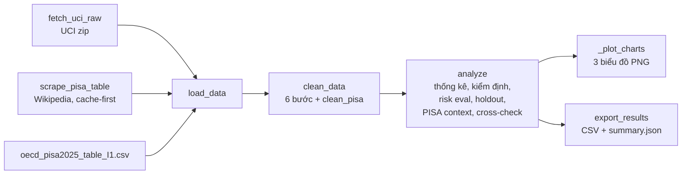
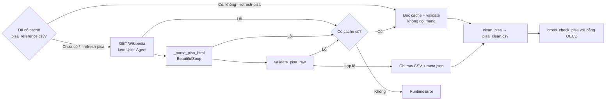

# Hướng dẫn Dự án P1 — Phân tích Điểm số Học sinh (bản gọn)

Tài liệu tổng quan dự án trên nhánh `slim-down`: mục tiêu, dữ liệu, quy trình làm sạch, cào dữ liệu, biểu đồ và bản đồ mã nguồn. Các phương pháp thống kê (công thức + code thật + kết quả thật) nằm ở file riêng `METHODS.md`.

Mọi con số lấy từ lần chạy `python main.py` (file `data/processed/summary.json`). Số dòng code đúng với `data_processor.py` hiện tại (832 dòng); nếu sửa code thì số dòng sẽ dịch, nên tra theo **tên hàm** là chắc nhất.

---

## 1. Dự án dùng để làm gì?

**Câu hỏi chính của đề:** Trong các yếu tố thời gian tự học, số buổi vắng, hỗ trợ gia đình, internet và điểm giữa kỳ, yếu tố nào liên quan rõ nhất tới điểm cuối kỳ G3 của học sinh THPT môn Toán (bộ dữ liệu UCI, 2 trường ở Bồ Đào Nha)?

3 mục tiêu:

1. **Tìm yếu tố liên quan tới điểm số:** mô tả và kiểm định khác biệt G3 giữa các nhóm (tự học, vắng, số lần trượt, internet, hỗ trợ…).
2. **Cảnh báo sớm:** quy tắc `classify_risk` chỉ dùng thông tin có trước kỳ thi cuối (G1, G2, `failures`, `absences`; **không dùng G3**) để nhận diện học sinh có nguy cơ trượt; kiểm chứng trên môn Bồ Đào Nha như dữ liệu ngoài mẫu.
3. **Bối cảnh quốc gia:** cào điểm PISA từ Wikipedia, kiểm định và đối chiếu với bảng chính thức của OECD.

**Đây là bản gọn.** Nhánh này chỉ tập trung vào: **thu thập → làm sạch → chuẩn hoá → EDA (3 biểu đồ) → kiểm định cơ bản** (Welch t-test, ANOVA, Holm, Pearson, đánh giá rule rủi ro). Báo cáo `report.md` (EN) và `report_vi.md` (VI) được viết tay, 1–2 trang. Các phần nâng cao đã bỏ được liệt kê ở mục 8.



---

## 2. G1, G2, G3 và quy tắc đỗ/trượt

Thang điểm Bồ Đào Nha: **0–20**.

| Điểm | Tên | Ý nghĩa |
|---|---|---|
| **G1** | First period grade | Điểm kỳ 1 |
| **G2** | Second period grade | Điểm kỳ 2 (giữa năm) |
| **G3** | Final grade | Điểm tổng kết cuối năm — **biến mục tiêu** |

- $G3 \ge 10$: **pass**; $G3 < 10$: **fail** (`calc_pass_fail`, `PASS_MARK = 10`).
- Tỉ lệ đỗ môn Toán: **67.1%** trên toàn bộ 395 em; **74.2%** trên 357 em sau khi bỏ nhóm G3 = 0.

### Phát hiện: 38 em có $G3 = 0$

- Trong 395 học sinh môn Toán có **38 em G3 = 0**.
- **Cả 38 em đều có `absences = 0`**, trong khi ở các em còn lại chỉ **21.6%** có `absences = 0`.
- 13/38 em cũng có G2 = 0; G1 trung bình của nhóm là **7.53**, G2 trung bình **4.66** — tức là các em có đi học, có điểm kỳ 1.
- **Diễn giải:** đây gần như chắc chắn là **bỏ thi / thôi học**, không phải "đi thi được 0 điểm". Histogram (mục 6) cho thấy không có em nào được 1, 2, 3 điểm.
- **Cách xử lý:** gắn cờ `dropout_suspect = True`, **không xoá** (ADR 0001). Phân tích chạy song song 2 phạm vi: `all` (395) và `exclude_dropout` = "core" (357). Kết luận về yếu tố ảnh hưởng dùng core để điểm 0 không làm méo trung bình và tương quan.
- 36/38 em này rơi vào `risk_group = high`, 2 em `medium`, 0 em `low` — rule cảnh báo sớm bắt được gần hết nhóm bỏ thi.

---

## 3. Các trường dữ liệu

Mỗi file gốc (`student-mat.csv`, `student-por.csv`, phân cách `;`) có **33 cột**, chia 5 nhóm:

### Nhóm 1: Cá nhân & trường
- `school`: `GP` (Gabriel Pereira) / `MS` (Mousinho da Silveira).
- `sex`: `F` / `M`.
- `age`: 15–22.
- `address`: `U` (thành thị) / `R` (nông thôn).
- `famsize`: `LE3` ($\le 3$ người) / `GT3` ($> 3$ người).
- `Pstatus`: `T` (bố mẹ sống chung) / `A` (sống riêng).

### Nhóm 2: Gia đình
- `Medu`, `Fedu`: học vấn mẹ / bố (0: không đi học, 1: tiểu học, 2: cấp 2, 3: cấp 3, 4: đại học).
- `Mjob`, `Fjob`: nghề mẹ / bố (`teacher`, `health`, `services`, `at_home`, `other`).
- `guardian`: người giám hộ (`mother`, `father`, `other`).
- `reason`: lý do chọn trường.

### Nhóm 3: Học tập & hỗ trợ
- `studytime`: tự học/tuần (1: <2h, 2: 2–5h, 3: 5–10h, 4: >10h).
- `failures`: số lần trượt trước đây (0–3).
- `schoolsup`, `famsup`, `paid`, `higher`, `internet`: `yes` / `no` (phụ đạo ở trường, gia đình hỗ trợ, học thêm trả phí, muốn học đại học, internet ở nhà).

### Nhóm 4: Đời sống, bạn bè, sức khoẻ
- `activities`, `nursery`, `romantic`: `yes` / `no`.
- `famrel`, `freetime`, `goout`, `Dalc`, `Walc`, `health`: thang 1–5.
- `traveltime`: 1: <15 phút, 2: 15–30 phút, 3: 30–60 phút, 4: >1 giờ.

### Nhóm 5: Chuyên cần & điểm
- `absences`: số buổi vắng (0–93).
- `G1`, `G2`, `G3`: 0–20.

### Cột do code tạo thêm
| Cột | Cách tính |
|---|---|
| `subject` | `mat` / `por` (gắn lúc `load_data`) |
| `<cột yes/no>_bin` | 8 cột `YES_NO_COLS` mã hoá 1/0 (`Int64`, lỗi → trống) |
| `pass_fail` | `calc_pass_fail(G3)` |
| `absence_level` | `low` (0–3), `medium` (4–9), `high` ($\ge 10$) |
| `avg_grade` | $(G1+G2+G3)/3$ — **chỉ để mô tả** (chứa G3) |
| `avg_g1g2` | $(G1+G2)/2$ — an toàn cho dự báo sớm |
| `risk_group` | `classify_risk`: `high` nếu $G2<10$ hoặc $failures \ge 2$; `medium` nếu $G1<10$ hoặc $failures>0$ hoặc vắng mức `high`; còn lại `low` |

### 6 cờ bất thường (chỉ đánh dấu True/False, không xoá dòng)

| Cờ | Điều kiện | mat | por |
|---|---|---|---|
| `dropout_suspect` | $G3 = 0$ | 38 | 15 |
| `g2_zero` | $G2 = 0$ | 13 | 7 |
| `grade_drop` | $(G1-G3 \ge 8$ hoặc $G2-G3 \ge 6)$ và không phải dropout | 0 | 1 |
| `absence_outlier` | `absences` > hàng rào IQR của môn (mat 20, por 15) | 15 | 21 |
| `age_outlier` | $age \ge 20$ | 5 | 9 |
| `inconsistent_grade` | $G3 > 0$ nhưng $G2 = 0$ | 0 | 0 |

---

## 4. Quy trình làm sạch & chuẩn hoá (`clean_data`, dòng 573–636)

Đầu vào: 1044 dòng (mat 395 + por 649), đọc bằng `dtype=str, keep_default_na=False` để **mọi giá trị giữ nguyên dạng chuỗi gốc** — lỗi nào cũng phải đi qua bước kiểm tra, không bị pandas âm thầm đổi.

Các hằng số dùng trong bước làm sạch:

```python
# data_processor.py, dòng 79–92
VALID_RANGES = {
    "age": (15, 22), "Medu": (0, 4), "Fedu": (0, 4),
    "traveltime": (1, 4), "studytime": (1, 4), "failures": (0, 3),
    "famrel": (1, 5), "freetime": (1, 5), "goout": (1, 5),
    "Dalc": (1, 5), "Walc": (1, 5), "health": (1, 5),
    "absences": (0, 93), "G1": (0, 20), "G2": (0, 20), "G3": (0, 20),
}
REQUIRED_COLS = ["G1", "G2", "G3", "absences", "failures", "studytime", "age"]

YES_NO_COLS = ["schoolsup", "famsup", "paid", "activities", "nursery",
               "higher", "internet", "romantic"]

FLAG_COLS = ["dropout_suspect", "g2_zero", "grade_drop",
             "absence_outlier", "age_outlier", "inconsistent_grade"]
```

`VALID_RANGES` lấy từ file mô tả gốc `data/raw/student.txt` (16 cột số).

### Bước 1 — Cắt khoảng trắng

```python
# dòng 578–582
        # 1) whitespace
        str_cols = [c for c in df.columns if c not in VALID_RANGES]
        stripped = df[str_cols].apply(lambda s: s.str.strip())
        log["n_cells_stripped"] = int((stripped != df[str_cols]).sum().sum())
        df[str_cols] = stripped
```

- **Kiểm tra:** ô chuỗi có khoảng trắng thừa (`" yes"` sẽ không khớp `"yes"`).
- **Kết quả thật:** `n_cells_stripped = 0`.

### Bước 2 — Ép kiểu số + kiểm tra miền giá trị

```python
# dòng 584–591
        # 2) numeric casts + domain checks (bad values -> NaN)
        log["n_non_numeric"], log["n_out_of_range"] = {}, {}
        for col, (lo, hi) in VALID_RANGES.items():
            num = pd.to_numeric(df[col], errors="coerce")
            log["n_non_numeric"][col] = int((num.isna() & (df[col] != "")).sum())
            bad = num.notna() & ~num.between(lo, hi)
            log["n_out_of_range"][col] = int(bad.sum())
            df[col] = num.mask(bad)
```

- **Kiểm tra:** giá trị không phải số (vd `"abc"`) và giá trị số nằm ngoài miền hợp lệ (vd `age = 30`, `G3 = 25`). Giá trị sai bị đổi thành `NaN` chứ không đoán sửa.
- **Kết quả thật:** 0 ô không phải số, 0 ô ngoài miền ở cả 16 cột.

### Bước 3 — Mã hoá yes/no có kiểm tra

```python
# dòng 108–115
def convert_yes_no(value) -> int | None:
    """Encode 'yes'/'no' (case-insensitive, stripped) to 1/0; anything else -> None."""
    text = str(value).strip().lower()
    if text == "yes":
        return 1
    if text == "no":
        return 0
    return None
```

```python
# dòng 593–598
        # 3) yes/no encoding with validation
        log["n_invalid_yes_no"] = {}
        for col in YES_NO_COLS:
            enc = df[col].map(convert_yes_no)
            log["n_invalid_yes_no"][col] = int(enc.isna().sum())
            df[col + "_bin"] = enc.astype("Int64")
```

- **Kiểm tra:** giá trị khác `yes`/`no` (vd `"maybe"`, ô trống) → `None`, được đếm, không bị ép thành 0. Cột gốc giữ nguyên, cột `_bin` dùng cho tương quan (vd `famsup_bin`).
- **Kết quả thật:** 0 giá trị lạ ở cả 8 cột.

### Bước 4 — Dòng trùng + thiếu giá trị bắt buộc

```python
# dòng 600–609
        # 4) duplicates (within subject) + missing required values
        before = len(df)
        df = df.drop_duplicates()
        log["n_duplicates_dropped"] = int(before - len(df))
        before = len(df)
        df = df.dropna(subset=REQUIRED_COLS).reset_index(drop=True)
        log["n_missing_required_dropped"] = int(before - len(df))
        for col in VALID_RANGES:
            if df[col].notna().all():
                df[col] = df[col].astype(int)
```

- **Kiểm tra:** dòng trùng hoàn toàn (có cột `subject` nên chỉ trùng trong cùng môn) và dòng thiếu một trong 7 cột `REQUIRED_COLS` (bao gồm các ô bị đổi thành `NaN` ở bước 2). Cột số nào đủ dữ liệu được ép về `int`.
- **Kết quả thật:** 0 dòng trùng, 0 dòng thiếu → `rows_out = 1044`.

### Bước 5 — Cột dẫn xuất

```python
# dòng 611–617
        # 5) derived columns
        df["pass_fail"] = df["G3"].apply(calc_pass_fail)
        df["absence_level"] = df["absences"].apply(classify_absences)
        df["avg_grade"] = df.apply(
            lambda r: calc_average_grade(r["G1"], r["G2"], r["G3"]), axis=1).round(2)
        df["avg_g1g2"] = ((df["G1"] + df["G2"]) / 2).round(2)
        df["risk_group"] = df.apply(classify_risk, axis=1)
```

**Lưu ý rò rỉ dữ liệu (data leakage):** `avg_grade` chứa chính G3, nên nếu dùng nó để "dự đoán" G3 thì tương quan sẽ cao giả tạo. Code ghi rõ trong docstring `calc_average_grade` và `VAR_DESCRIPTIONS` là chỉ dùng mô tả; dự báo sớm dùng `avg_g1g2`. Tương tự, `classify_risk` không đọc G3 (ADR 0002) để có thể đánh giá công bằng với `pass_fail`.

### Bước 6 — Cờ bất thường (đánh dấu, không xoá)

```python
# dòng 619–630
        # 6) anomaly flags (flag, never delete); absence fence per subject
        q = df.groupby("subject")["absences"].quantile([0.25, 0.75]).unstack()
        fences = (q[0.75] + IQR_K * (q[0.75] - q[0.25])).to_dict()
        df["dropout_suspect"] = df["G3"] == 0
        df["g2_zero"] = df["G2"] == 0
        df["grade_drop"] = (((df["G1"] - df["G3"]) >= G1_DROP) | ((df["G2"] - df["G3"]) >= G2_DROP)) \
            & ~df["dropout_suspect"]
        df["absence_outlier"] = df["absences"] > df["subject"].map(fences)
        df["age_outlier"] = df["age"] >= AGE_OUTLIER
        df["inconsistent_grade"] = (df["G3"] > 0) & (df["G2"] == 0)
        log["absence_outlier_fence"] = {k: float(v) for k, v in fences.items()}
        log["rows_out"] = int(len(df))
```

Hàng rào IQR (Tukey) tính **riêng từng môn**:

$$IQR = Q3 - Q1, \qquad \text{fence} = Q3 + 1.5 \times IQR$$

| Môn | Q1 | Q3 | IQR | Fence |
|---|---|---|---|---|
| mat | 0 | 8 | 8 | $8 + 1.5 \times 8 = 20$ |
| por | 0 | 6 | 6 | $6 + 1.5 \times 6 = 15$ |

Ngưỡng lấy từ `ANOMALY_THRESHOLDS = (1.5, 8, 6, 20)` (dòng 35): `IQR_K`, `G1_DROP`, `G2_DROP`, `AGE_OUTLIER`. Số lượng cờ: xem bảng ở mục 3.

Cuối hàm (dòng 632–636) lưu `self.clean`, `self.cleaning_log` và gọi `clean_pisa` nếu đã nạp PISA.

### Vì sao log toàn 0 mà vẫn cần làm sạch?

Bộ UCI sạch về **mặt hình thức**: không ô lỗi, không trùng, không thiếu. Nhưng vấn đề thật là **ngữ nghĩa**: 38 điểm G3 = 0 hợp lệ trong miền 0–20 nên không bước kiểm tra cú pháp nào bắt được. Nếu coi chúng là điểm thi thật:

- tỉ lệ đỗ bị kéo xuống (67.1% thay vì 74.2%);
- tương quan G2–G3 tụt từ **0.966** (core) xuống **0.905** (all), G1–G3 từ 0.892 xuống 0.801;
- tương quan `absences`–G3 trên tập all là **+0.034** (vắng nhiều lại "điểm cao hơn") vì 38 em điểm 0 đều có vắng = 0; trên core thì đúng chiều: **−0.213**.

Do đó bước 6 (cờ) quan trọng hơn cả 5 bước trước trên dữ liệu thật, và kết luận chính dùng phạm vi core.

---

## 5. Thu thập dữ liệu & web scraping

| Nguồn | Cách lấy | File lưu | Hàm |
|---|---|---|---|
| UCI Student Performance | Tải zip qua HTTP (không cào HTML) | `data/raw/student-mat.csv`, `student-por.csv`, `student.txt`, `student-merge.R` | `fetch_uci_raw` (173–186) |
| Wikipedia — bài PISA | **Cào HTML** bằng `requests` + `BeautifulSoup` | `data/raw/pisa_reference.csv` + `pisa_reference.meta.json` | `scrape_pisa_table` (309–347), `_parse_pisa_html` (197–251) |
| OECD — *PISA 2025 Results (Vol. I)*, Table I.1 | Chép từ PDF chính thức, chỉ để **đối chiếu** | `data/raw/oecd_pisa2025_table_I1.csv` + `.meta.json` | `cross_check_pisa` (369–410) |

`fetch_uci_raw` chỉ tải khi thiếu file: zip ngoài chứa `student.zip`, code giải nén 2 lớp trong RAM (`io.BytesIO`) rồi ghi 4 file vào `data/raw/`.

### 5.1 Luồng cào PISA



### 5.2 Gửi request lịch sự
- `requests.get(url, timeout=25, headers=HTTP_HEADERS)` (dòng 323).
- `HTTP_HEADERS` (dòng 166–169): User-Agent `P1-edu-project/1.0 (+https://github.com/Stratoze/Python-data-scraping) student coursework` — chính sách Wikimedia yêu cầu công cụ tự động khai tên + cách liên hệ.
- `raise_for_status()` biến lỗi HTTP thành exception để rơi vào nhánh fallback; ép `resp.encoding = "utf-8"`.
- Chỉ 1 request mỗi lần cào; mặc định đọc cache nên bình thường không gọi mạng.

### 5.3 Bóc tách HTML (`_parse_pisa_html`, dòng 197–251)
Duyệt mọi `table.wikitable`, nhận diện 2 loại bảng **theo cấu trúc** (không theo thứ tự trên trang):
1. **Bảng tóm tắt mới nhất (2025)**, `source = "summary"`: hàng đầu là tên 3 môn và chứa đúng 3 bảng con `Rank | Country/economy | Score`; năm lấy từ tiêu đề `<h2>/<h3>` gần nhất. Dòng "International Average (OECD)" chỉ có 2 ô → vẫn giữ, hạng trống.
2. **Bảng so sánh lịch sử 2000–2022**, `source = "comparison"`: hàng 1 là tên môn, hàng 2 `Country` + các năm, hàng 3 `Score | Rank`. Chuyển **wide → long**; dòng có số ô ≠ $1 + 2 \times \text{số năm}$ bị bỏ qua.
- `find_all("tr", recursive=False)` để không lẫn hàng của bảng con; `_strip_footnote` bỏ chú thích `[41]`. Không tìm thấy bảng → `ValueError("No PISA ranking table found")`.
- File raw giữ nguyên chuỗi gốc (có `*`, `—`) để truy vết.

Kết quả: **2342 dòng** = 274 dòng tóm tắt 2025 + 2068 dòng lịch sử.

### 5.4 Kiểm định bảng cào (`validate_pisa_raw`, dòng 258–290)
Parser có thể chạy không lỗi nhưng ra dữ liệu sai khi Wikipedia đổi bố cục. Hàm gom **mọi** lỗi vào 1 `ValueError`:
- đủ 3 môn cho cả `summary` và `comparison`;
- năm là số, từ 2000 đến năm hiện tại;
- điểm trong khoảng 200–700 (`PISA_CHECKS = (30, 200, 700)`, dòng 39);
- mỗi (loại bảng, môn, năm): $\ge 30$ nước có điểm, nước nào cũng có hạng là số, không trùng nước, **đúng 1** dòng trung bình OECD.

### 5.5 Cache-first + fallback (`scrape_pisa_table`, dòng 309–347)
- Mặc định đọc cache (vẫn validate lại) → chạy offline, mỗi lần ra cùng số.
- Cào mới: `python main.py --refresh-pisa`. Thành công và hợp lệ → ghi đè cache kèm `meta.json` (URL, `revision_id` lấy từ `"wgRevisionId"`, permalink `?oldid=...`, thời điểm UTC, số dòng). Bản đang dùng: revision **1378067005**, cào lúc **2026-10-13 06:44 UTC**.
- Lỗi mạng / parse / validate → `warnings.warn` rồi dùng cache cũ; không có cache → `RuntimeError`.

### 5.6 Làm sạch PISA (`clean_pisa`, dòng 350–366)
- Tên nước: bỏ `[..]`, bỏ `*` cuối; "International Average (OECD)" → `OECD average`.
- `year`, `rank`, `score` ép số; `—` (không tham gia) → bỏ dòng; bỏ trùng theo (năm, môn, nước).
- Kết quả: `data/processed/pisa_clean.csv`, **1662 dòng**.

### 5.7 Đối chiếu OECD (`cross_check_pisa`, dòng 369–410)
- Chuẩn hoá tên nước bằng `OECD_NAME_ALIASES` (dòng 59–60, 5 tên khác nhau).
- **2025:** so trực tiếp → **274/274 khớp tuyệt đối**.
- **2022:** OECD in mức thay đổi, nên suy ra điểm 2022 = điểm 2025 − mức thay đổi, cho lệch ±1 do làm tròn → **208/211 trong ±1** (3 chênh lệch đều là Palestinian Authority).

### 5.8 Bối cảnh Bồ Đào Nha (`_pisa_context`, dòng 696–711)
Môn Toán, Bồ Đào Nha so với trung bình OECD:

| Năm | 2000 | 2003 | 2006 | 2009 | 2012 | 2015 | 2018 | 2022 | 2025 |
|---|---|---|---|---|---|---|---|---|---|
| Bồ Đào Nha | 454 | 466 | 466 | 487 | 487 | 492 | 492 | 472 | 460 |
| OECD | 492 | 499 | 494 | 495 | 494 | 490 | 489 | 472 | 463 |

Năm khảo sát UCI (2005–06) Bồ Đào Nha thấp hơn OECD (466 vs 494). Đây chỉ là bối cảnh **cấp quốc gia**, không ghép với từng học sinh; bản gọn không vẽ biểu đồ PISA, số liệu nằm trong `summary.json` (`pisa_context`).

### 5.9 Vì sao thiết kế như vậy
- **Raw tách khỏi clean:** sửa logic làm sạch không cần cào lại; raw là bằng chứng gốc.
- **Nhận bảng theo cấu trúc:** bền khi trang thêm/bớt bảng.
- **Validate trước khi ghi cache:** một lần cào hỏng không phá dữ liệu tốt.
- **Cache + revision id:** tái lập được kết quả.
- **Đối chiếu OECD:** chứng minh số cào về đáng tin.

---

## 6. Ý nghĩa 3 biểu đồ

Sinh tự động bởi `matplotlib` khi chạy `python main.py`, lưu ở `images/`:

```
images/
├── 01_bar_studytime_internet.png
├── 02_hist_g3.png
└── 03_heatmap_corr.png
```

### Ảnh 1 — `01_bar_studytime_internet.png` (`_plot_bar`, dòng 731–765)
- Cột nhóm: trục X 4 mức tự học, trục Y G3 trung bình (0–20), xanh = không internet, cam = có internet; tính trên core (357 em).
- Error bar = khoảng tin cậy 95% xấp xỉ $\bar x \pm 1.96\, s/\sqrt{n}$; nhãn `n=...`; cột có $n <$ `MIN_RELIABLE_N` (10) bị gạch chéo, làm mờ.
- **Đọc:** G3 trung bình theo studytime 1/2/3/4 = 11.47 / 11.07 / 12.56 / 12.67 — tăng nhẹ, không đều. Có internet cao hơn ~1 điểm nhưng sau Holm **không còn ý nghĩa** ($p_{holm} = 0.0804$). Nhóm ">10h, không internet" chỉ có $n = 3$, "5–10h, không internet" $n = 5$ → không kết luận.

### Ảnh 2 — `02_hist_g3.png` (`_plot_hist`, dòng 767–788)
- Mỗi cột = 1 điểm nguyên; xanh = G3 > 0, đỏ = 38 em G3 = 0; vạch đứt ở 9.5 (mốc đỗ); khung chữ ghi tỉ lệ đỗ 67.1% (all) và 74.2% (excl. dropout).
- **Đọc:** điểm thi thật có dạng chuông quanh 10–11; khoảng 1–3 trống rồi vọt lên cột 0 → bằng chứng trực quan rằng G3 = 0 là hiện tượng tách biệt (bỏ thi), không phải điểm kém.

### Ảnh 3 — `03_heatmap_corr.png` (`_plot_heatmap`, dòng 790–808)
- Tương quan Pearson giữa `CORR_COLS` (G1, G2, G3, studytime, failures, absences, famsup) trên core; thang `RdBu_r` từ −1 (xanh) tới +1 (đỏ); che nửa tam giác trên vì ma trận đối xứng.
- **Đọc:** G2–G3 = 0.966, G1–G3 = 0.892 (điểm giữa năm gần như quyết định G3); `failures` −0.294 và `absences` −0.213 là yếu tố kéo điểm xuống rõ nhất; `studytime` +0.127 yếu; `famsup` −0.067 không có ý nghĩa.

---

## 7. Các phương pháp thống kê

Chi tiết từng phương pháp (bản chất, công thức, code thật, kết quả thật, ý nghĩa) nằm ở file riêng **`METHODS.md`**: p-value, Welch t-test, Holm, one-way ANOVA + η², kiểm định tương quan Pearson, đánh giá rule cảnh báo sớm (precision, recall, holdout).

---

## 8. Các phần đã bỏ khỏi bản gọn

Vẫn còn đầy đủ trên nhánh `main`.

| Phần đã bỏ | Lý do bỏ ở bản gọn |
|---|---|
| Hồi quy OLS + sai số HC3 (`_ols`, `_regression`, `REG_FACTORS`) | Vượt phạm vi "kiểm định cơ bản"; tự code ma trận khó giải thích ngắn |
| Kruskal–Wallis | Chỉ là đối chứng phi tham số cho ANOVA, không đổi kết luận |
| Cohen's d | $\eta^2$ và CI của chênh lệch đã đủ nói độ lớn hiệu ứng |
| Wilson CI (`_wilson`) | CI cho recall/precision — bổ sung, không bắt buộc |
| Fisher exact + đánh giá tầng (`_tier_eval`) | So medium vs low trên mẫu nhỏ; thông tin phụ |
| Phân tích độ nhạy (`_sensitivity`) | 3 kịch bản xử lý điểm 0/vắng 0; core vs all đã thể hiện ý chính |
| t-test ghép cặp + Wilcoxon 2 môn (`_paired_subjects`), so sánh 2 môn (`_subject_comparison`) | Ngoài câu hỏi chính (môn Toán) |
| Biểu đồ 4 PISA (`_plot_pisa`, `04_pisa_portugal_oecd.png`) | Đề yêu cầu 3 biểu đồ; PISA giữ ở dạng số liệu |
| `report_builder.py`, `export_pdf.py` (sinh report/PDF tự động) | Báo cáo nay viết tay 1–2 trang; bỏ phụ thuộc `markdown-it-py`, `pygments` |

---

## 9. Thư viện sử dụng (`requirements.txt`)

| Thư viện | Phiên bản | Vai trò |
|---|---|---|
| `pandas` | >= 2.0 | Đọc/ghi CSV, làm sạch, `groupby`, ma trận tương quan |
| `numpy` | >= 1.26 | Mảng số: bins histogram, mặt nạ heatmap, CI error bar |
| `matplotlib` | >= 3.7 | Vẽ 3 biểu đồ; `main.py` đặt backend `Agg` để chỉ ghi PNG |
| `scipy` | >= 1.11 | `stats.ttest_ind` (Welch), `stats.f_oneway` (ANOVA), `stats.pearsonr` (r, p, CI) |
| `requests` | >= 2.31 | Tải zip UCI, GET trang Wikipedia kèm User-Agent |
| `beautifulsoup4` | >= 4.12 | Phân tích HTML, tìm `table.wikitable` |
| `notebook` | >= 7.0 | Chạy `analysis.ipynb` |
| `pytest` | >= 8.0 | Chạy 43 test tự động |

---

## 10. Bản đồ mã nguồn

Tổng code (không tính test): **904 dòng** — `data_processor.py` 832 + `main.py` 72.

### 10.1 `main.py`
- Dòng 5–7: `matplotlib.use("Agg")` trước khi import, chỉ ghi file PNG.
- `main()` dòng 20–68:
  - 21–24: `argparse`, cờ `--refresh-pisa`.
  - 26: `fetch_uci_raw(RAW)`.
  - 29–35: `scrape_pisa_table(...)` cache-first; lỗi thì bỏ qua PISA (dữ liệu tham khảo, không bắt buộc).
  - 37–44: `load_data()` → `clean_data()` → `analyze()`.
  - 45–63: in tỉ lệ đỗ, tương quan, rule rủi ro + holdout, kết quả Holm, số cờ, đối chiếu OECD.
  - 65–68: `export_results()` và tên 3 biểu đồ.

### 10.2 `data_processor.py`

**Hằng số**

| Tên | Dòng | Nội dung |
|---|---|---|
| `THRESHOLDS` | 31 | `(10, 10, 4, 10, 2)`: PASS_MARK, G_WARN, ABS_MED, ABS_HIGH, FAIL_HIGH |
| `ANOMALY_THRESHOLDS` | 35 | `(1.5, 8, 6, 20)`: IQR_K, G1_DROP, G2_DROP, AGE_OUTLIER |
| `PISA_CHECKS` | 39 | `(30, 200, 700)` |
| `ALPHA` | 43 | 0.05 |
| `BINARY_TEST_COLS` / `MULTI_TEST_COLS` | 44 / 45 | biến t-test / ANOVA |
| `TEST_LEVEL_CAP` | 47 | `{"failures": 2}` |
| `MIN_RELIABLE_N` | 49 | 10 |
| `CORR_TEST_COLS` | 50 | biến kiểm định Pearson |
| `MERGE_KEYS` | 53–54 | 13 cột định danh học sinh |
| `OECD_PISA_YEAR`, `OECD_NAME_ALIASES` | 58, 59–60 | đối chiếu OECD |
| `VAR_DESCRIPTIONS` | 63–76 | dict mô tả biến |
| `VALID_RANGES`, `REQUIRED_COLS` | 79–85, 86 | miền giá trị, cột bắt buộc |
| `YES_NO_COLS`, `FLAG_COLS` | 88–89, 91–92 | 8 cột yes/no, 6 cờ |
| `SAMPLE_STUDENTS` | 95–102 | list of dicts mẫu |
| `UCI_ZIP_URL`, `HTTP_HEADERS` | 162, 166–169 | nguồn UCI, User-Agent |
| `CORR_COLS` | 424 | cột heatmap/tương quan |

**Hàm cấp module**

| Hàm | Dòng | Vai trò |
|---|---|---|
| `convert_yes_no` | 108–115 | yes→1, no→0, khác→None |
| `calc_pass_fail` | 118–120 | G3 ≥ 10 → pass |
| `classify_absences` | 123–130 | low / medium / high |
| `calc_average_grade` | 133–139 | (G1+G2+G3)/3, chỉ mô tả |
| `classify_risk` | 142–156 | rule cảnh báo sớm, không dùng G3 |
| `fetch_uci_raw` | 173–186 | tải + giải nén zip UCI |
| `_parse_pisa_html` | 197–251 | BeautifulSoup → bảng dài |
| `validate_pisa_raw` | 258–290 | kiểm định bảng cào |
| `scrape_pisa_table` | 309–347 | cache-first + fallback + meta |
| `clean_pisa` | 350–366 | làm sạch PISA |
| `cross_check_pisa` | 369–410 | đối chiếu OECD 2025/2022 |
| `_grp` | 416–421 | mean/std/n của G3 theo nhóm |
| `_p` | 427–429 | làm tròn p-value |
| `_holm` | 432–438 | hiệu chỉnh Holm |
| `_group_tests` | 441–477 | Welch t-test + ANOVA/$\eta^2$ + Holm |
| `_corr_tests` | 480–488 | Pearson r, p, CI |
| `_scope_stats` | 491–516 | gom thống kê 1 phạm vi (all/core) |
| `_risk_eval` | 519–535 | ma trận nhầm lẫn, precision, recall |

**Class `StudentDataProcessor`**

| Phương thức | Dòng | Vai trò |
|---|---|---|
| `load_data` | 559–570 | đọc 2 CSV (gắn `subject`), PISA raw, bảng OECD |
| `clean_data` | 573–636 | 6 bước làm sạch + `clean_pisa` |
| `analyze` | 639–676 | uniques (`set`), cleaning log, số cờ, `_scope_stats` cho all/core, `_risk_eval` + holdout, hồ sơ dropout, PISA, vẽ biểu đồ |
| `_risk_holdout` | 678–694 | holdout por và por_only |
| `_pisa_context` | 696–711 | Bồ Đào Nha vs OECD theo năm |
| `_plot_charts` | 713–717 | gọi 3 hàm vẽ |
| `_save_fig` | 719–729 | lưu PNG, báo rõ nếu file bị khoá |
| `_plot_bar` | 731–765 | biểu đồ 1 |
| `_plot_hist` | 767–788 | biểu đồ 2 |
| `_plot_heatmap` | 790–808 | biểu đồ 3 |
| `export_results` | 811–832 | `cleaned_students.csv` (1044 dòng), `cleaned_students_mat.csv`, `cleaned_students_por.csv`, `pisa_clean.csv`, `summary.json`; báo rõ nếu file đang mở trong Excel/WPS |

### 10.3 `tests/` — 43 test (`tests/test_data_processor.py`, dùng fixture trong `conftest.py`)
- **Hàm cơ bản:** biên đỗ/trượt (9, 9.99, 10, 20), biên mức vắng, `convert_yes_no` từ chối giá trị lạ.
- **Rule rủi ro:** kết quả không đổi khi đổi G3; các ngưỡng `high`/`medium`/`low`.
- **Thống kê:** `_holm` đơn điệu và chặn trên 1.0; `_group_tests` gộp failures 2, 3 thành "2+".
- **Cào PISA:** parser đọc đúng HTML mẫu; `validate_pisa_raw` chấp nhận bảng đúng và bắt các dạng bảng hỏng; `clean_pisa` chuẩn hoá tên và bỏ nước không tham gia; `cross_check_pisa` chỉ báo chênh lệch thật; cache-first không gọi mạng; refresh với trang hỏng giữ nguyên cache.
- **Làm sạch:** dữ liệu cấy lỗi (tuổi 30, yes/no lạ, dòng trùng, khoảng trắng) được đếm đúng và gắn cờ dropout.
- **Holdout:** `holdout_por_only` loại học sinh trùng với môn Toán.
- **Xuất file:** `export_results` ghi file gộp và 2 file riêng theo môn.

Chạy: `pytest`.

---

## 11. Bảng tra nhanh số liệu cốt lõi

| Chỉ số | Giá trị |
|---|---|
| Dòng thô | 1044 (mat 395, por 649) |
| Cleaning log | 0 strip, 0 non-numeric, 0 out-of-range, 0 yes/no lạ, 0 trùng, 0 thiếu; rows_out 1044 |
| Hàng rào IQR vắng | mat 20, por 15 |
| Cờ mat (dropout/g2_zero/grade_drop/abs/age/inconsistent) | 38 / 13 / 0 / 15 / 5 / 0 |
| Cờ por | 15 / 7 / 1 / 21 / 9 / 0 |
| Dropout (mat) | 38 em, 38/38 vắng = 0, 13 có G2 = 0, G1 TB 7.53, G2 TB 4.66; nhóm khác 21.6% vắng = 0 |
| Tỉ lệ đỗ mat | all 67.1% (n 395), core 74.2% (n 357) |
| Tương quan all | G1–G3 0.801, G2–G3 0.905, absences–G3 +0.034 |
| Tương quan core | G1–G2 0.902, G1–G3 0.892, G2–G3 0.966 |
| Welch internet | 11.68 vs 10.71, diff +0.98 [0.11, 1.84], p 0.0268 → p_holm 0.0804 (không ý nghĩa) |
| Welch schoolsup | diff −2.21 [−3.02, −1.41], p_holm 3.4e-06 (nhân quả ngược) |
| ANOVA $\eta^2$ | studytime 0.036, absence_level 0.053, failures (0/1/2+) 0.089 |
| Pearson core | failures −0.294, absences −0.213, studytime +0.127, famsup −0.067 (p 0.205) |
| Rule high, mat all | recall 93.8% (122/130), precision 81.9% (122/149) |
| Rule high, holdout chặt por_only | n 275, recall 91.4% (64/70), precision 66.0% (64/97) |
| Dropout theo risk_group | high 36, medium 2, low 0 |
| PISA | raw 2342 dòng, clean 1662 dòng, revision 1378067005 |
| Đối chiếu OECD | 2025: 274/274 khớp; 2022: 208/211 trong ±1 |
| Toán Bồ Đào Nha vs OECD | 2006: 466/494; 2025: 460/463 |
| Code | `data_processor.py` 832 dòng, `main.py` 72, 43 test |
