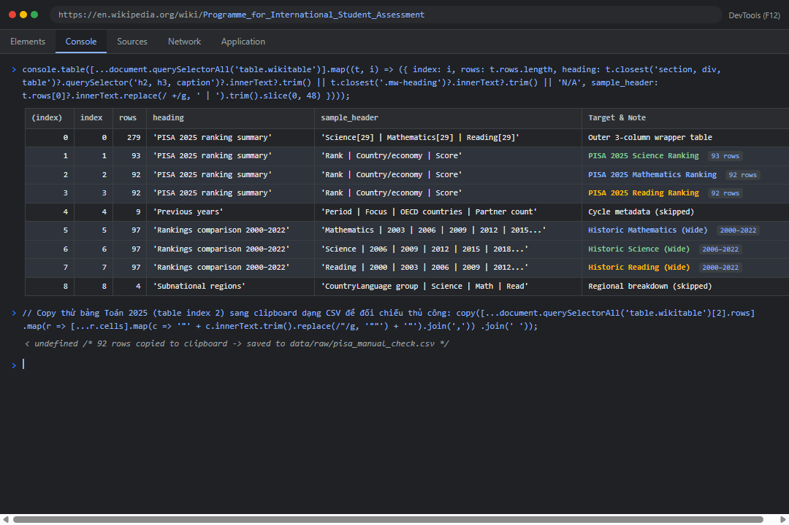
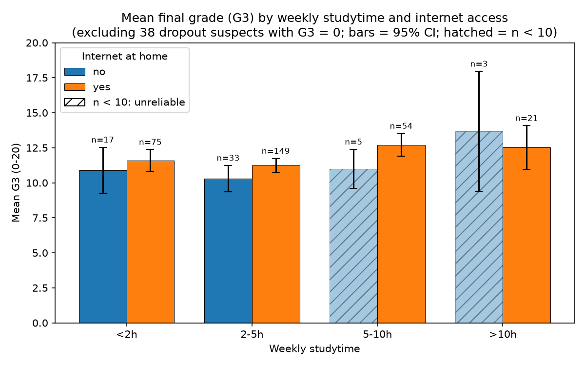
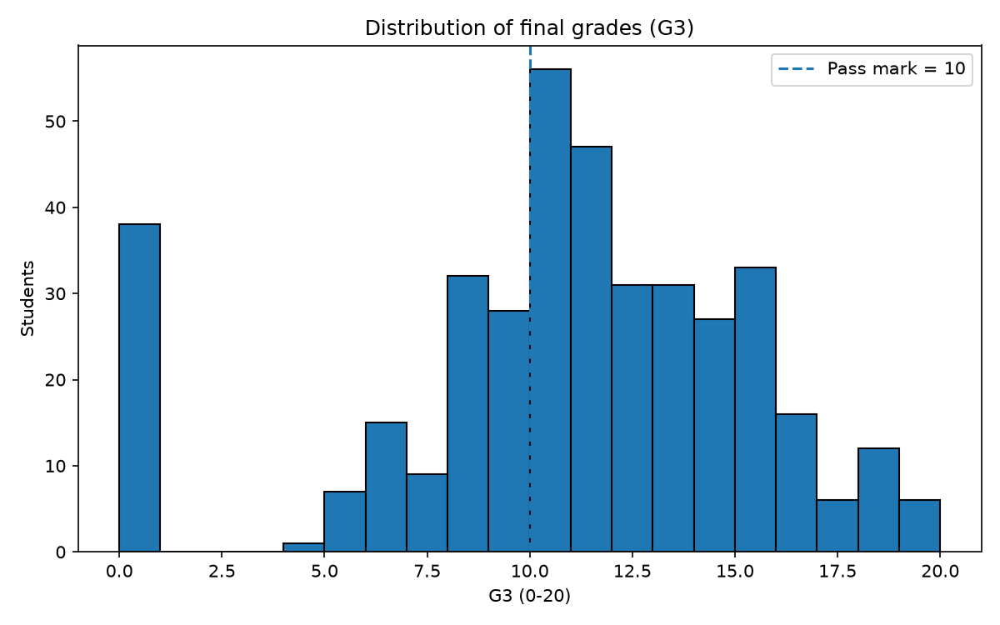
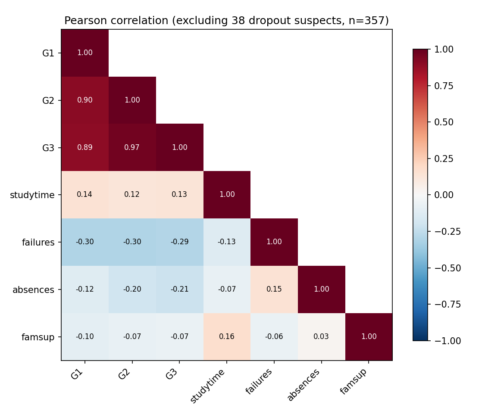
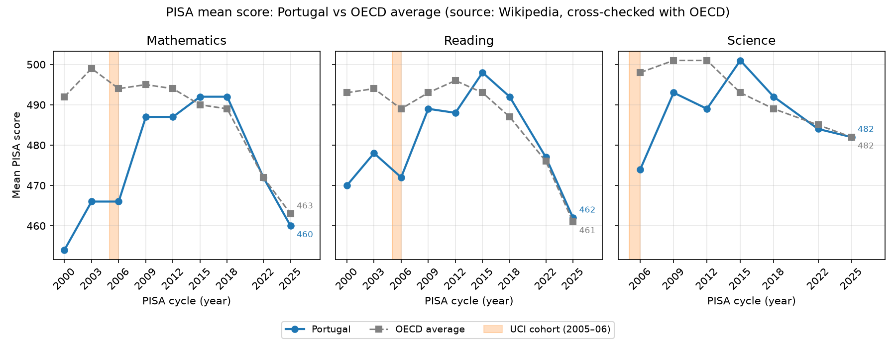

# P1 Report — Factors Affecting Final Grades (UCI Student Performance, `mat`)

> Generated automatically by `report_builder.py` on 2026-10-13 from the same results written to
> `data/processed/summary.json`. Every number below is computed by the pipeline and every code block
> is read from the current source file, so the report cannot drift from the code or the data.
> Re-generate with `python main.py`.

**Main question:** How do study time, absences, family support and intermediate grades (G1, G2)
relate to the final grade (G3)?

## 1. Executive summary

| Question | Answer (mathematics, 357 students with G3 > 0 unless stated) |
|---|---|
| Intermediate grades → G3 | Strongest link: r(G2, G3) = **0.966**, r(G1, G3) = 0.892 |
| Past failures → G3 | 0 failures: **11.94**, 1: 10.15, 2: 8.83, 3: 8.27 (r = -0.294) |
| Absences → G3 | low 12.26 / medium 11.38 / high 10.37 (r = **-0.213**, ANOVA Holm p < 0.001) |
| Study time → G3 | weak positive, r = 0.127 (ANOVA Holm p 0.019, eta² = 0.036: small) |
| Internet at home → G3 | yes 11.68 vs no 10.71; raw p 0.027, Holm p 0.080 → **not significant after correction** |
| All factors together (regression) | background factors explain R² = 0.234; significant in both courses with the others held fixed: **studytime (+1 bucket), failures (+1 past failure), absences (+1 absence), schoolsup (yes vs no)**; internet adjusted b = +0.53 (p 0.247) |
| Family support (`famsup`) → G3 | yes 11.35 vs no 11.8 (Holm p 0.404): **no significant difference** |
| Pass rate | 67.1% of all 395 students; 74.2% after removing 38 dropout suspects |
| Early-warning rule (no G3) | designed on mat: recall 93.8%, precision 81.9%; **tested on unseen Portuguese-only students: recall 91.4%, precision 66.0%** |

**Key data-quality finding:** 38 students have G3 = 0 and **38 of them have 0 recorded
absences**. They are treated as *dropout suspects* (flagged, not deleted). Including them flips the absences
correlation to r = 0.034 and hides the real negative effect.

## 2. Requirement checklist

| Requirement (assignment sheet) | Where it is done | Section |
|---|---|---|
| UCI Student Performance dataset (`student.zip`) | `fetch_uci_raw()` | 3.1 |
| Web scraping: Wikipedia PISA | `scrape_pisa_table()`, `_parse_pisa_html()`, `validate_pisa_raw()` | 3.2 |
| Save raw CSV | `data/raw/student-*.csv`, `data/raw/pisa_reference.csv` | 3 |
| Clean data types, encode yes/no | `clean_data()` | 5 |
| 4 basic functions (yes/no, pass/fail, absence level, average grade) | `convert_yes_no`, `calc_pass_fail`, `classify_absences`, `calc_average_grade` | 4 |
| list of dicts, dict mapping, set of unique schools/jobs, tuple thresholds | `SAMPLE_STUDENTS`, `VAR_DESCRIPTIONS`, `set()` in `analyze()`, `THRESHOLDS` | 4 |
| EDA with groupby, mean, std | `_grp()`, `_scope_stats()` | 7 |
| Compare G3 by studytime, absences, failures, internet | `by_*` tables | 7 |
| Pass/fail; learning-risk groups | `pass_fail`, `classify_risk()`, `_risk_eval()` | 7, 9 |
| Correlation G1, G2, G3 | `corr_G1_G2_G3`, heatmap | 7, 8.3 |
| Bar chart, histogram, heatmap | `_plot_bar`, `_plot_hist`, `_plot_heatmap` | 8 |
| OOP: `load_data()`, `clean_data()`, `analyze()`, `export_results()`; `main.py` exports `cleaned_students.csv` + `summary.json` | `StudentDataProcessor`, `main.py` | 11 |
| Insights and limitations | — | 12, 13 |

## 3. Data collection

### 3.1 UCI Student Performance

**What was done:** the official UCI zip is downloaded only if the raw CSVs are missing, then the inner
`student.zip` is extracted into `data/raw/`. Raw files are never edited afterwards.

| File | Rows | Columns | Role |
|---|---|---|---|
| `student-mat.csv` | 395 | 33 | Primary analysis (mathematics) |
| `student-por.csv` | 649 | 33 | Replication / comparison (Portuguese) |

`data_processor.py` — `fetch_uci_raw` (lines 179–192)

```python
def fetch_uci_raw(raw_dir: Path, url: str = UCI_ZIP_URL) -> list[Path]:
    """Download UCI student.zip and extract raw files if any are missing."""
    raw_dir = Path(raw_dir)
    targets = [raw_dir / name for name in UCI_FILES]
    if all(p.exists() for p in targets):
        return targets
    raw_dir.mkdir(parents=True, exist_ok=True)
    resp = requests.get(url, timeout=60, headers=HTTP_HEADERS)
    resp.raise_for_status()
    with zipfile.ZipFile(io.BytesIO(resp.content)) as outer:
        with zipfile.ZipFile(io.BytesIO(outer.read("student.zip"))) as inner:
            for name in UCI_FILES:
                (raw_dir / name).write_bytes(inner.read(name))
    return targets
```

**Why it can be trusted:** the URL is the official UCI download; files are byte-for-byte what UCI ships;
row/column counts match the UCI description (395 / 649 students, 33 attributes).

### 3.2 Wikipedia PISA (web scraping)

**Step 1 — Browser inspection with DevTools (Console, F12):**
Before writing automated Python scraper code, the Wikipedia page structure was inspected interactively via Chrome/Edge DevTools:
1. Opened the target article and launched **F12 → Console**.
2. Ran a JavaScript DOM snippet to list and inspect all 12 `table.wikitable` elements:
   - Index 1, 2, 3: latest PISA 2025 summary rankings (Science, Mathematics, Reading);
   - Index 5, 6, 7: historical rankings comparison 2000–2022 (wide layout).
3. Copied the 2025 Mathematics table to clipboard via `copy(...)` and saved to `data/raw/pisa_manual_check.csv` (92 rows) for manual verification.



**Step 2 — Automated Python pipeline (`requests` + `BeautifulSoup`):**
1. `requests.get` downloads the HTML of the [PISA article](https://en.wikipedia.org/wiki/Programme_for_International_Student_Assessment) (no headless browser needed at runtime: tables are static HTML).
2. `BeautifulSoup` parses the DOM and extracts the two targeted table families:
   - **summary**: latest ranking (`Rank | Country/economy | Score`), one nested table per subject;
   - **comparison**: "Rankings comparison 2000–2022", one row per country with `score, rank` pairs per year (converted from wide to long).
3. The result (2342 rows, page strings untouched) is saved to `data/raw/pisa_reference.csv`.
4. Collection is **cache-first**: normal runs read the saved CSV; `python main.py --refresh-pisa` re-scrapes.

| Provenance | Value |
|---|---|
| Wikipedia revision | [1378067005](https://en.wikipedia.org/w/index.php?oldid=1378067005) |
| Scraped at (UTC) | 2026-10-13T06:44:49+00:00 |
| Raw rows | 2342 |
| Licence | CC BY-SA 4.0 (Wikipedia) |
| User-Agent | `P1-edu-project/1.0 (https://github.com/Stratoze/Python-data-scraping; mailto:vohoangquocminh2k5@gmail.com) student coursework` |
| Manual check file | `data/raw/pisa_manual_check.csv` (92 rows via DevTools) |
`data_processor.py` — `scrape_pisa_table` (lines 315–353)

```python
def scrape_pisa_table(url: str = PISA_URL, out_csv: Path | None = None,
                      refresh: bool = False) -> pd.DataFrame:
    """Cache-first PISA scrape from Wikipedia into a raw long CSV.

    - Cache exists and refresh=False: read and validate the cache, no network.
    - Otherwise fetch live, parse, validate; only a valid result overwrites the
      cache, together with <out_csv>.meta.json (url, revision id, permalink, time).
    - Live fetch/parse/validation fails: warn and fall back to a valid cache,
      else raise RuntimeError.
    """
    cache = Path(out_csv) if out_csv is not None else None
    if cache is not None and cache.exists() and not refresh:
        return _read_pisa_cache(cache)
    try:
        resp = requests.get(url, timeout=25, headers=HTTP_HEADERS)
        resp.raise_for_status()
        resp.encoding = "utf-8"
        df = _parse_pisa_html(resp.text)
        validate_pisa_raw(df)
    except Exception as exc:
        if cache is not None and cache.exists():
            warnings.warn(f"Live PISA scrape failed ({type(exc).__name__}: {exc}); "
                          f"keeping cached {cache.name}", stacklevel=2)
            return _read_pisa_cache(cache)
        raise RuntimeError(f"PISA scrape failed: {type(exc).__name__}: {exc}") from exc
    if cache is not None:
        cache.parent.mkdir(parents=True, exist_ok=True)
        df.to_csv(cache, index=False, encoding="utf-8")
        rev = re.search(r'"wgRevisionId":(\d+)', resp.text)
        meta = {
            "url": url,
            "revision_id": int(rev.group(1)) if rev else None,
            "permalink": (f"https://en.wikipedia.org/w/index.php?oldid={rev.group(1)}"
                          if rev else None),
            "scraped_at": datetime.now(timezone.utc).isoformat(timespec="seconds"),
            "n_rows": int(len(df)),
        }
        _meta_path(cache).write_text(json.dumps(meta, indent=2), encoding="utf-8")
    return df
```

`data_processor.py` — `_parse_pisa_html` (lines 203–257)

```python
def _parse_pisa_html(html: str) -> pd.DataFrame:
    """Extract PISA ranking tables into a raw long table (all values as page strings).

    - summary  : latest 'ranking summary' tables (Rank | Country/economy | Score),
                 subject order taken from the container table header.
    - comparison: 'Rankings comparison' tables (Country | year score/rank pairs).
    """
    soup = BeautifulSoup(html, "html.parser")
    rows: list[dict] = []
    for table in soup.find_all("table", class_="wikitable"):
        trs = table.find_all("tr", recursive=False) or table.select(":scope > tbody > tr")
        if not trs:
            continue
        head = _cell_texts(trs[0])
        heading = table.find_previous(["h2", "h3"])
        heading_text = heading.get_text(" ", strip=True) if heading else ""

        # Container of the latest ranking summary: header lists the subjects,
        # nested tables hold Rank | Country/economy | Score in the same order.
        subjects = [_strip_footnote(h).lower() for h in head]
        nested = table.find_all("table", class_="wikitable")
        if nested and all(s in PISA_SUBJECTS for s in subjects) and len(nested) == len(subjects):
            year_match = re.search(r"(\d{4})", heading_text)
            year = year_match.group(1) if year_match else ""
            for subject, sub in zip(subjects, nested):
                for tr in sub.find_all("tr")[1:]:
                    cells = _cell_texts(tr)
                    if len(cells) == 3:
                        rank, country, score = cells
                    elif len(cells) == 2:  # e.g. "International Average (OECD)" has no rank
                        rank, (country, score) = "", cells
                    else:
                        continue
                    rows.append({"source": "summary", "year": year,
                                 "subject": PISA_SUBJECTS[subject],
                                 "rank": rank, "country": country, "score": score})
            continue

        # Historical comparison: single-cell subject title, then Country | years, then Score/Rank.
        if (len(head) == 1 and _strip_footnote(head[0]).lower() in PISA_SUBJECTS
                and len(trs) > 3 and _cell_texts(trs[1])[:1] == ["Country"]):
            subject = PISA_SUBJECTS[_strip_footnote(head[0]).lower()]
            years = [_strip_footnote(y) for y in _cell_texts(trs[1])[1:]]
            for tr in trs[3:]:
                cells = _cell_texts(tr)
                if len(cells) != 1 + 2 * len(years):
                    continue
                country = cells[0]
                for k, year in enumerate(years):
                    rows.append({"source": "comparison", "year": year, "subject": subject,
                                 "rank": cells[2 + 2 * k], "country": country,
                                 "score": cells[1 + 2 * k]})
    if not rows:
        raise ValueError("No PISA ranking table found")
    return pd.DataFrame(rows, columns=["source", "year", "subject", "rank", "country", "score"])
```

**Why it can be trusted — structural validation.** Every scraped table (and every cache read) must pass
`validate_pisa_raw()`; otherwise it is rejected and the previous cache is kept:

- both table families contain all 3 subjects;
- every year is a number between 2000 and the current year;
- every score lies in [200, 700];
- every (source, subject, year) has ≥ 30 countries with a score, numeric ranks, no duplicate country and exactly one OECD-average row.

`data_processor.py` — `validate_pisa_raw` (lines 264–296)

```python
def validate_pisa_raw(df: pd.DataFrame) -> None:
    """Sanity-check a raw PISA table; raise ValueError listing every problem.

    Catches silent mis-parses after a Wikipedia layout change: missing table
    families, wrong subject/year labels, empty or implausible score columns.
    """
    problems: list[str] = []
    for src in ("summary", "comparison"):
        got = set(df.loc[df["source"] == src, "subject"])
        if got != set(PISA_SUBJECTS.values()):
            problems.append(f"{src}: subjects {sorted(got)} != {sorted(PISA_SUBJECTS.values())}")
    years = _to_num(df["year"])
    bad_year = years.isna() | ~years.between(2000, datetime.now().year)
    if bad_year.any():
        problems.append(f"invalid year values: {sorted(set(df.loc[bad_year, 'year']))}")
    score = _to_num(df["score"])
    out_of_range = score.notna() & ~score.between(PISA_SCORE_MIN, PISA_SCORE_MAX)
    if out_of_range.any():
        problems.append(f"{int(out_of_range.sum())} scores outside "
                        f"[{PISA_SCORE_MIN}, {PISA_SCORE_MAX}]")
    is_avg = df["country"].str.contains("International Average", case=False)
    for (src, subj, year), g in df.groupby(["source", "subject", "year"]):
        countries = g[~is_avg.loc[g.index] & score.loc[g.index].notna()]
        if len(countries) < PISA_MIN_COUNTRIES:
            problems.append(f"{src}/{subj}/{year}: only {len(countries)} countries with a score")
        if _to_num(countries["rank"]).isna().any():
            problems.append(f"{src}/{subj}/{year}: country rows without numeric rank")
        if countries["country"].duplicated().any():
            problems.append(f"{src}/{subj}/{year}: duplicated countries")
        if int(is_avg.loc[g.index].sum()) != 1:
            problems.append(f"{src}/{subj}/{year}: expected exactly 1 OECD average row")
    if problems:
        raise ValueError("PISA validation failed: " + "; ".join(problems))
```

### 3.3 PISA cleaning

Footnotes (`[41]`) and trailing `*` are removed from country names, `—` (did not participate) becomes
missing, rank/score/year become numbers, "International Average (OECD)" is renamed `OECD average`.
Result: 1662 rows in `data/processed/pisa_clean.csv`.

`data_processor.py` — `clean_pisa` (lines 356–372)

```python
def clean_pisa(raw: pd.DataFrame) -> pd.DataFrame:
    """Normalise the raw PISA long table: numeric rank/score/year, clean country names."""
    df = raw.copy()
    df["country"] = (df["country"].astype(str)
                     .map(_strip_footnote)
                     .str.replace(r"\s*\*+$", "", regex=True)
                     .str.strip())
    df.loc[df["country"].str.contains("International Average", case=False), "country"] = "OECD average"
    for col in ["year", "rank", "score"]:
        df[col] = _to_num(df[col])
    df = df.dropna(subset=["year", "score"])  # country did not take part that year
    df["year"] = df["year"].astype(int)
    df["score"] = df["score"].astype(int)
    df["rank"] = df["rank"].astype("Int64")
    return (df.drop_duplicates(subset=["year", "subject", "country"])
              .sort_values(["subject", "year", "rank"])
              .reset_index(drop=True))
```

### 3.4 Cross-check against the official OECD report

**What was done.** Wikipedia is a secondary source, so the scraped numbers are compared with the **official OECD
publication**: OECD (2026), PISA 2025 Results (Volume I): Future-Ready Students, OECD Publishing, Paris, Table I.1. Snapshot of performance in science, reading, mathematics and computational problem-solving (page 30) ([DOI](https://doi.org/10.1787/73451bc5-en), licence CC BY 4.0).
The table was extracted once from the OECD PDF into `data/raw/oecd_pisa2025_table_I1.csv` (92 rows:
OECD average + every participating country). Five country names differ between the two sources and are mapped
(`OECD_NAME_ALIASES`, e.g. "Chinese Taipei" → "Taiwan").

| Cycle | How compared | Pairs compared | Within tolerance | Exact | Max |diff| | Mismatches (Wikipedia vs OECD) |
|---|---|---|---|---|---|---|
| 2025 | direct, must match exactly | 274 | 274 | 274 | 0 | — |
| 2022 | derived = 2025 score − change, ±1 allowed for rounding | 211 | 208 | 161 | 7 | Palestinian Authority mathematics 366 vs 372; Palestinian Authority science 369 vs 376; Palestinian Authority reading 349 vs 356 |

Countries in the OECD table but missing from a Wikipedia table: mathematics: Uzbekistan; reading: Uzbekistan.

**Portugal and OECD average (the rows this report actually uses):**

| Country | Subject | Wikipedia | OECD official | Match |
|---|---|---|---|---|
| Portugal | mathematics | 460 | 460 | ✅ |
| Portugal | reading | 462 | 462 | ✅ |
| Portugal | science | 482 | 482 | ✅ |
| OECD average | mathematics | 463 | 463 | ✅ |
| OECD average | reading | 461 | 461 | ✅ |
| OECD average | science | 482 | 482 | ✅ |

**Why it can be trusted:** every 2025 score scraped from Wikipedia equals the official OECD value, and
the 2022 values (derived from the OECD change column) agree within rounding except for the rows listed as
mismatches above, which do not affect Portugal. Earlier cycles (2000–2018) are not covered by this OECD table and
remain Wikipedia-only.

`data_processor.py` — `cross_check_pisa` (lines 375–416)

```python
def cross_check_pisa(pisa: pd.DataFrame, oecd: pd.DataFrame) -> dict:
    """Compare scraped Wikipedia PISA scores with the official OECD Table I.1.

    - OECD_PISA_YEAR scores must match exactly (both are rounded means).
    - The previous cycle (2022) is derived as score - change; because OECD
      computes the change from unrounded means, a difference of 1 is allowed.
    """
    o = oecd.copy()
    o["country"] = o["country"].str.replace(r"\s*\*+$", "", regex=True).str.strip().replace(OECD_NAME_ALIASES)
    rows = []
    for subject in PISA_SUBJECTS.values():
        score, change = _to_num(o[subject]), _to_num(o[f"{subject}_change"])
        rows.append(pd.DataFrame({"country": o["country"], "subject": subject,
                                  "year": OECD_PISA_YEAR, "oecd": score}))
        rows.append(pd.DataFrame({"country": o["country"], "subject": subject,
                                  "year": OECD_PISA_YEAR - 3, "oecd": score - change}))
    ref = pd.concat(rows).dropna(subset=["oecd"])
    merged = ref.merge(pisa[["country", "subject", "year", "score"]],
                       on=["country", "subject", "year"], how="inner")
    merged["diff"] = merged["score"] - merged["oecd"]
    out: dict = {}
    for year, tol in ((OECD_PISA_YEAR, 0), (OECD_PISA_YEAR - 3, 1)):
        g = merged[merged["year"] == year]
        bad = g[g["diff"].abs() > tol]
        out[str(year)] = {
            "tolerance": tol,
            "n_compared": int(len(g)),
            "n_within_tolerance": int(len(g) - len(bad)),
            "n_exact": int((g["diff"] == 0).sum()),
            "max_abs_diff": int(g["diff"].abs().max()) if len(g) else None,
            "mismatches": bad[["country", "subject", "score", "oecd"]].astype(
                {"score": int, "oecd": int}).to_dict("records"),
        }
    latest = pisa[pisa["year"] == OECD_PISA_YEAR]
    official = set(o["country"])
    out["missing_in_wikipedia"] = {
        s: sorted(official - set(latest.loc[latest["subject"] == s, "country"]))
        for s in PISA_SUBJECTS.values()}
    out["missing_in_oecd"] = {
        s: sorted(set(latest.loc[latest["subject"] == s, "country"]) - official)
        for s in PISA_SUBJECTS.values()}
    return out
```

## 4. Python basics required by the assignment

Configuration (tuples, dict mappings, list of dicts) — real source:

`data_processor.py` (lines 28–108)

```python
# Threshold config as tuples (immutable, per rubric)
# ---------------------------------------------------------------------------
# (PASS_MARK, G_WARN, ABS_MED, ABS_HIGH, FAIL_HIGH)
THRESHOLDS = (10, 10, 4, 10, 2)
PASS_MARK, G_WARN, ABS_MED, ABS_HIGH, FAIL_HIGH = THRESHOLDS

# Anomaly flags: (IQR_K, G1_DROP, G2_DROP, AGE_OUTLIER)
ANOMALY_THRESHOLDS = (1.5, 8, 6, 20)
IQR_K, G1_DROP, G2_DROP, AGE_OUTLIER = ANOMALY_THRESHOLDS

# PISA scrape sanity checks: (MIN_COUNTRIES per subject/year, SCORE_MIN, SCORE_MAX)
PISA_CHECKS = (30, 200, 700)
PISA_MIN_COUNTRIES, PISA_SCORE_MIN, PISA_SCORE_MAX = PISA_CHECKS

# Statistical tests: significance level and the variables whose G3 groups are compared
ALPHA = 0.05
BINARY_TEST_COLS = ["internet", "famsup", "schoolsup", "paid"]
MULTI_TEST_COLS = ["studytime", "absence_level", "failures"]
# Sparse levels merged before ANOVA/Kruskal: failures 2 and 3 have ~12 students each -> one "2+" group
TEST_LEVEL_CAP = {"failures": 2}
# Chart 1 bars with fewer students are drawn hatched: their mean is not reliable
MIN_RELIABLE_N = 10
CORR_TEST_COLS = ["G1", "G2", "studytime", "failures", "absences", "famsup_bin"]

# Columns identifying the same student in student-mat and student-por (student-merge.R)
MERGE_KEYS = ["school", "sex", "age", "address", "famsize", "Pstatus", "Medu", "Fedu",
              "Mjob", "Fjob", "reason", "nursery", "internet"]

# Multivariable regression of G3 (each coefficient = effect with all other columns held fixed).
# Background factors: the main-question variables plus socio-economic / demographic controls.
REG_FACTORS = ["studytime", "failures", "absences", "famsup_bin", "schoolsup_bin", "paid_bin",
               "internet_bin", "higher_bin", "Medu", "Fedu", "male", "age", "urban"]
REG_GRADES = ["G1", "G2"]

# OECD PISA 2025 Table I.1 (official source used to cross-check the Wikipedia scrape).
# Country names that differ between the OECD report and Wikipedia:
OECD_PISA_YEAR = 2025
OECD_NAME_ALIASES = {"Chinese Taipei": "Taiwan", "Czechia": "Czech Republic", "Korea": "South Korea",
                     "Slovak Republic": "Slovakia", "Viet Nam": "Vietnam"}

# Variable description mapping (dict mapping, per rubric)
VAR_DESCRIPTIONS = {
    "studytime": "Weekly study time bucket 1-4 (<2h, 2-5h, 5-10h, >10h)",
    "absences": "Number of school absences",
    "failures": "Number of past class failures",
    "internet": "Internet access at home (yes/no)",
    "G1": "First period grade (0-20)",
    "G2": "Second period grade (0-20)",
    "G3": "Final grade (0-20)",
    "schoolsup": "Extra educational support from school (yes/no)",
    "famsup": "Family educational support (yes/no)",
    "paid": "Extra paid classes within the course subject (yes/no)",
    "avg_grade": "Mean of G1, G2, G3 (descriptive only: contains target G3, DO NOT use as predictor)",
    "avg_g1g2": "Mean of G1 and G2 (mid-year performance; safe for early prediction)",
}

# Valid value domain per numeric column (from data/raw/student.txt)
VALID_RANGES = {
    "age": (15, 22), "Medu": (0, 4), "Fedu": (0, 4),
    "traveltime": (1, 4), "studytime": (1, 4), "failures": (0, 3),
    "famrel": (1, 5), "freetime": (1, 5), "goout": (1, 5),
    "Dalc": (1, 5), "Walc": (1, 5), "health": (1, 5),
    "absences": (0, 93), "G1": (0, 20), "G2": (0, 20), "G3": (0, 20),
}
REQUIRED_COLS = ["G1", "G2", "G3", "absences", "failures", "studytime", "age"]

YES_NO_COLS = ["schoolsup", "famsup", "paid", "activities", "nursery",
               "higher", "internet", "romantic"]

FLAG_COLS = ["dropout_suspect", "g2_zero", "grade_drop",
             "absence_outlier", "age_outlier", "inconsistent_grade"]

# Sample students as list of dicts (per rubric)
SAMPLE_STUDENTS = [
    {"id": 1, "studytime": 2, "absences": 6, "failures": 0,
     "internet": "yes", "G1": 5, "G2": 6, "G3": 6},
    {"id": 2, "studytime": 2, "absences": 4, "failures": 0,
     "internet": "no", "G1": 5, "G2": 5, "G3": 6},
    {"id": 3, "studytime": 3, "absences": 10, "failures": 3,
     "internet": "yes", "G1": 7, "G2": 8, "G3": 10},
]
```

The four basic functions:

`data_processor.py` — `convert_yes_no` (lines 114–121)

```python
def convert_yes_no(value) -> int | None:
    """Encode 'yes'/'no' (case-insensitive, stripped) to 1/0; anything else -> None."""
    text = str(value).strip().lower()
    if text == "yes":
        return 1
    if text == "no":
        return 0
    return None
```

`data_processor.py` — `calc_pass_fail` (lines 124–126)

```python
def calc_pass_fail(g3: float, pass_mark: int = PASS_MARK) -> str:
    """Return 'pass' if G3 >= pass_mark else 'fail'."""
    return "pass" if float(g3) >= pass_mark else "fail"
```

`data_processor.py` — `classify_absences` (lines 129–136)

```python
def classify_absences(n: int) -> str:
    """Bucket absences: low (0-3) / medium (4-9) / high (>=10)."""
    n = int(n)
    if n < ABS_MED:
        return "low"
    if n < ABS_HIGH:
        return "medium"
    return "high"
```

`data_processor.py` — `calc_average_grade` (lines 139–145)

```python
def calc_average_grade(g1: float, g2: float, g3: float) -> float:
    """Mean of the three grade periods: (G1 + G2 + G3) / 3.

    WARNING: Contains the target G3. Descriptive only; NEVER use as a predictor
    for G3 to prevent target leakage. For early prediction, use avg_g1g2 instead.
    """
    return (float(g1) + float(g2) + float(g3)) / 3.0
```

`set()` of unique values (computed in `analyze()`): schools = `['GP', 'MS']`, mother's jobs = `['at_home', 'health', 'other', 'services', 'teacher']`, father's jobs = `['at_home', 'health', 'other', 'services', 'teacher']`.

## 5. Data cleaning

**What was done** (`StudentDataProcessor.clean_data()`, order matters: cast → validate → drop → derive → flag).
Rows in: 1044 (both subjects) → rows out: 1044.

| Step | How | Rows/cells affected |
|---|---|---|
| 1. Strip whitespace in text columns | `str.strip()` | 0 |
| 2a. Cast 16 numeric columns | `pd.to_numeric(errors='coerce')` | 0 |
| 2b. Domain check against `student.txt` | `VALID_RANGES` → out-of-range becomes NaN | 0 |
| 3. Encode yes/no → 1/0, anything else → NaN | `convert_yes_no` | 0 |
| 4a. Drop duplicate rows | `drop_duplicates()` | 0 |
| 4b. Drop rows missing a required column | `dropna(subset=REQUIRED_COLS)` | 0 |

Derived columns: `pass_fail` (G3 ≥ 10), `absence_level` (low 0–3 / medium 4–9 / high ≥ 10),
`avg_grade` (G1+G2+G3)/3 (descriptive only: contains target G3 so DO NOT use as predictor to prevent data leakage; use `avg_g1g2` for early prediction), `avg_g1g2`, `risk_group`, and 6 anomaly flags.

`data_processor.py` — `StudentDataProcessor.load_data` (lines 667–678)

```python
def load_data(self) -> pd.DataFrame:
    frames = []
    for subject, path in self.raw_paths.items():
        part = pd.read_csv(path, sep=";", dtype=str, keep_default_na=False)
        part.insert(0, "subject", subject)
        frames.append(part)
    self.df = pd.concat(frames, ignore_index=True)
    if self.pisa_raw is not None and self.pisa_raw.exists():
        self.pisa_df = pd.read_csv(self.pisa_raw, dtype=str, keep_default_na=False)
    if self.oecd_raw is not None and self.oecd_raw.exists():
        self.oecd_df = pd.read_csv(self.oecd_raw, dtype=str, keep_default_na=False)
    return self.df
```

`data_processor.py` — `StudentDataProcessor.clean_data` (lines 681–744)

```python
def clean_data(self) -> pd.DataFrame:
    assert self.df is not None, "call load_data() first"
    df = self.df.copy()
    log: dict = {"rows_in": int(len(df))}

    # 1) whitespace
    str_cols = [c for c in df.columns if c not in VALID_RANGES]
    stripped = df[str_cols].apply(lambda s: s.str.strip())
    log["n_cells_stripped"] = int((stripped != df[str_cols]).sum().sum())
    df[str_cols] = stripped

    # 2) numeric casts + domain checks (bad values -> NaN)
    log["n_non_numeric"], log["n_out_of_range"] = {}, {}
    for col, (lo, hi) in VALID_RANGES.items():
        num = pd.to_numeric(df[col], errors="coerce")
        log["n_non_numeric"][col] = int((num.isna() & (df[col] != "")).sum())
        bad = num.notna() & ~num.between(lo, hi)
        log["n_out_of_range"][col] = int(bad.sum())
        df[col] = num.mask(bad)

    # 3) yes/no encoding with validation
    log["n_invalid_yes_no"] = {}
    for col in YES_NO_COLS:
        enc = df[col].map(convert_yes_no)
        log["n_invalid_yes_no"][col] = int(enc.isna().sum())
        df[col + "_bin"] = enc.astype("Int64")

    # 4) duplicates (within subject) + missing required values
    before = len(df)
    df = df.drop_duplicates()
    log["n_duplicates_dropped"] = int(before - len(df))
    before = len(df)
    df = df.dropna(subset=REQUIRED_COLS).reset_index(drop=True)
    log["n_missing_required_dropped"] = int(before - len(df))
    for col in VALID_RANGES:
        if df[col].notna().all():
            df[col] = df[col].astype(int)

    # 5) derived columns
    df["pass_fail"] = df["G3"].apply(calc_pass_fail)
    df["absence_level"] = df["absences"].apply(classify_absences)
    df["avg_grade"] = df.apply(
        lambda r: calc_average_grade(r["G1"], r["G2"], r["G3"]), axis=1).round(2)
    df["avg_g1g2"] = ((df["G1"] + df["G2"]) / 2).round(2)
    df["risk_group"] = df.apply(classify_risk, axis=1)

    # 6) anomaly flags (flag, never delete); absence fence per subject
    q = df.groupby("subject")["absences"].quantile([0.25, 0.75]).unstack()
    fences = (q[0.75] + IQR_K * (q[0.75] - q[0.25])).to_dict()
    df["dropout_suspect"] = df["G3"] == 0
    df["g2_zero"] = df["G2"] == 0
    df["grade_drop"] = (((df["G1"] - df["G3"]) >= G1_DROP) | ((df["G2"] - df["G3"]) >= G2_DROP)) \
        & ~df["dropout_suspect"]
    df["absence_outlier"] = df["absences"] > df["subject"].map(fences)
    df["age_outlier"] = df["age"] >= AGE_OUTLIER
    df["inconsistent_grade"] = (df["G3"] > 0) & (df["G2"] == 0)
    log["absence_outlier_fence"] = {k: float(v) for k, v in fences.items()}
    log["rows_out"] = int(len(df))

    self.clean = df
    self.cleaning_log = log
    if self.pisa_df is not None:
        self.pisa_clean = clean_pisa(self.pisa_df)
    return df
```

**Why it can be trusted:** each check *counts* what it changed and the counts are stored in
`summary.json → cleaning_log`. All 0 — i.e. the raw UCI data is structurally clean; the only real
problem is semantic (G3 = 0, section 6). Nothing is silently coerced: an unexpected value would become NaN
and show up in these counts.

### 5.1 Anomaly flags (flag, never delete)

| Flag | Rule | Count (mat) | Count (por) | Meaning |
|---|---|---|---|---|
| `dropout_suspect` | `G3 == 0` | 38 | 15 | Likely did not sit the final exam / left school |
| `g2_zero` | `G2 == 0` | 13 | 7 | Likely absent for period 2 |
| `grade_drop` | `G1−G3 ≥ 8` or `G2−G3 ≥ 6`, dropouts excluded | 0 | 1 | Sudden grade drop |
| `absence_outlier` | `absences > Q3 + 1.5·IQR` (= 20 in mat) | 15 | 21 | Unusually many absences |
| `age_outlier` | `age ≥ 20` | 5 | 9 | Late start / repeated years |
| `inconsistent_grade` | `G3 > 0` but `G2 == 0` | 0 | 0 | Contradictory grades |

Thresholds come from the tuple `ANOMALY_THRESHOLDS = (1.5, 8, 6, 20)` (IQR factor, G1 drop, G2 drop, age).
The IQR fence is computed per subject because the two courses have different absence distributions.

## 6. Dropout suspects (G3 = 0)

| Evidence | Value |
|---|---|
| Students with G3 = 0 | 38 |
| … of which absences = 0 | **38 / 38** |
| … of which G2 = 0 | 13 |
| Their mean G1 / G2 | 7.53 / 4.66 |
| Share of absences = 0 among other students | 21.6% |
| Students with G3 between 1 and 3 | 0 (empty gap before the zeros) |

**Interpretation:** these students had real G1 grades, then a zero final grade with zero recorded absences.
A genuine grade of 0/20 after G1 ≈ 7.53 is implausible; "did not sit the exam / left school, absences
not recorded" is the consistent explanation. They are kept in `cleaned_students.csv` with `dropout_suspect = True`
and every statistic is reported twice: **all** (n = 395) and **exclude_dropout** (n = 357).

| Statistic | all (n=395) | exclude_dropout (n=357) |
|---|---|---|
| Pass rate | 67.1% | **74.2%** |
| r(G2, G3) | 0.905 | **0.966** |
| r(G1, G3) | 0.801 | **0.892** |
| r(absences, G3) | 0.034 | **-0.213** |
| r(failures, G3) | -0.36 | **-0.294** |

### 6.1 Sensitivity analysis: does the conclusion depend on how the zeros are treated?

**What was done.** Two assumptions could be wrong: (1) G3 = 0 means "dropped out", and (2) absences = 0 means "never
absent" — it might instead mean "not recorded". The absences analysis is therefore repeated under three scenarios, in
both courses, and the result is compared.

| Course | Scenario | n | r(absences, G3) [95% CI] | p | Mean G3 low / medium / high | ANOVA p | Pass rate |
|---|---|---|---|---|---|---|---|
| mat | all students | 395 | **+0.034** [-0.065, 0.132] | 0.497 | 9.82 / 11.38 / 10.37 | 0.013 | 67.1% |
| mat | exclude dropout suspects (G3 = 0) | 357 | **-0.213** [-0.31, -0.112] | < 0.001 | 12.26 / 11.38 / 10.37 | < 0.001 | 74.2% |
| mat | also exclude absences = 0 (maybe 'not recorded') | 280 | **-0.176** [-0.287, -0.06] | 0.003 | 11.91 / 11.38 / 10.37 | 0.008 | 71.4% |
| por | all students | 649 | **-0.091** [-0.167, -0.015] | 0.020 | 12.07 / 11.88 / 11.13 | 0.082 | 84.6% |
| por | exclude dropout suspects (G3 = 0) | 634 | **-0.196** [-0.27, -0.12] | < 0.001 | 12.57 / 11.88 / 11.13 | < 0.001 | 86.6% |
| por | also exclude absences = 0 (maybe 'not recorded') | 405 | **-0.142** [-0.237, -0.046] | 0.004 | 12.12 / 11.88 / 11.13 | 0.034 | 83.7% |

Dropout pattern in both courses: mat: 38/38 dropout suspects have absences = 0 (vs 21.6% of other students), por: 15/15 dropout suspects have absences = 0 (vs 36.1% of other students).

**Interpretation:**
- In every scenario that removes the zeros, absences have a **significant negative** relationship with G3 in both courses. The conclusion holds whether or not the dropout assumption is right and whether or not absences = 0 is real.
- Only the "all students" scenario hides or weakens the effect — exactly the distortion caused by the G3 = 0 rows.
- The dropout pattern (G3 = 0 always together with absences = 0) appears in both courses, which supports reading it as "not assessed / left school" rather than a real grade.

`data_processor.py` — `StudentDataProcessor._sensitivity` (lines 804–839)

```python
def _sensitivity(self) -> dict:
    """Does the absences finding survive different assumptions about the zeros?

    - all: keep every student;
    - exclude_dropout: drop G3 = 0 (dropout suspects);
    - exclude_dropout_and_zero_absences: also drop absences = 0, in case 0 means
      'not recorded' rather than 'never absent'.
    """
    out: dict = {}
    for subj, g in self.clean.groupby("subject"):
        scenarios = {
            "all": g,
            "exclude_dropout": g[~g["dropout_suspect"]],
            "exclude_dropout_and_zero_absences": g[~g["dropout_suspect"] & (g["absences"] > 0)],
        }
        res = {}
        for name, d in scenarios.items():
            r = stats.pearsonr(d["absences"].astype(float), d["G3"].astype(float))
            ci = r.confidence_interval(1 - ALPHA)
            levels = [x["G3"].astype(float).to_numpy() for _, x in d.groupby("absence_level")]
            res[name] = {
                "n": int(len(d)),
                "r_absences_G3": round(float(r.statistic), 3), "p": _p(r.pvalue),
                "ci95": [round(float(ci.low), 3), round(float(ci.high), 3)],
                "mean_G3_by_absence_level": {
                    k: round(float(x["G3"].mean()), 2) for k, x in d.groupby("absence_level")},
                "anova_p": _p(stats.f_oneway(*levels).pvalue),
                "pass_rate": round(float((d["pass_fail"] == "pass").mean()), 4),
            }
        drop = g[g["dropout_suspect"]]
        res["dropout_pattern"] = {"n_dropout": int(len(drop)),
                                  "n_dropout_absences_zero": int((drop["absences"] == 0).sum()),
                                  "share_absences_zero_others": round(float(
                                      (g.loc[~g["dropout_suspect"], "absences"] == 0).mean()), 4)}
        out[subj] = res
    return out
```

## 7. Exploratory analysis (groupby → mean ± std, n)

Cells show *mean G3 ± standard deviation (n students)*. Bold = headline scope.

**By weekly study time**

| Studytime | all | exclude_dropout |
|---|---|---|
| 1 (<2h) | 10.05 ± 4.96 (n=105) | **11.47** ± 3.41 (n=92) |
| 2 (2-5h) | 10.17 ± 4.22 (n=198) | **11.07** ± 3.07 (n=182) |
| 3 (5-10h) | 11.4 ± 4.64 (n=65) | **12.56** ± 2.99 (n=59) |
| 4 (>10h) | 11.26 ± 5.28 (n=27) | **12.67** ± 3.6 (n=24) |

**By absence level** — mean G3 decreases steadily from low to high absences once dropout suspects are removed.

| Absence level | all | exclude_dropout |
|---|---|---|
| low | 9.82 ± 5.61 (n=191) | **12.26** ± 3.04 (n=153) |
| medium | 11.38 ± 3.25 (n=121) | **11.38** ± 3.25 (n=121) |
| high | 10.37 ± 3.2 (n=83) | **10.37** ± 3.2 (n=83) |

**By past failures**

| Failures | all | exclude_dropout |
|---|---|---|
| 0 | 11.25 ± 4.17 (n=312) | **11.94** ± 3.19 (n=294) |
| 1 | 8.12 ± 4.71 (n=50) | **10.15** ± 2.6 (n=40) |
| 2 | 6.24 ± 4.84 (n=17) | **8.83** ± 3.01 (n=12) |
| 3 | 5.69 ± 4.19 (n=16) | **8.27** ± 1.68 (n=11) |

Change in mean G3 between consecutive levels (exclude_dropout): 0→1: -1.79, 1→2: -1.32, 2→3: -0.56. The **first failure** comes with the biggest drop; later failures still lower G3 but by less. Small groups: 2 (n = 12), 3 (n = 11).

**By internet at home / family support / school support / paid classes**

| Group | all | exclude_dropout |
|---|---|---|
| internet = no | 9.41 ± 4.49 (n=66) | **10.71** ± 2.97 (n=58) |
| internet = yes | 10.62 ± 4.58 (n=329) | **11.68** ± 3.26 (n=299) |
| famsup = no | 10.64 ± 4.64 (n=153) | **11.8** ± 3.18 (n=138) |
| famsup = yes | 10.27 ± 4.55 (n=242) | **11.35** ± 3.25 (n=219) |
| schoolsup = no | 10.56 ± 4.77 (n=344) | **11.83** ± 3.22 (n=307) |
| schoolsup = yes | 9.43 ± 2.87 (n=51) | **9.62** ± 2.55 (n=50) |
| paid = no | 9.99 ± 5.13 (n=214) | **11.61** ± 3.4 (n=184) |
| paid = yes | 10.92 ± 3.79 (n=181) | **11.43** ± 3.04 (n=173) |

Note: `schoolsup = yes` students score lower because extra school support is *given to* weaker students
(reverse causality) — this is not evidence that support lowers grades.

`data_processor.py` — `_grp` (lines 422–427)

```python
def _grp(df: pd.DataFrame, col: str) -> dict:
    g = df.groupby(col)["G3"].agg(["mean", "std", "count"])
    return {str(k): {"mean": round(float(v["mean"]), 2),
                     "std": round(float(v["std"]), 2) if pd.notna(v["std"]) else 0.0,
                     "n": int(v["count"])}
            for k, v in g.iterrows()}
```

`data_processor.py` — `_scope_stats` (lines 569–594)

```python
def _scope_stats(df: pd.DataFrame) -> dict:
    corr = df[CORR_COLS].astype(float).corr().round(3)
    return {
        "n": int(len(df)),
        "pass_rate": round(float((df["pass_fail"] == "pass").mean()), 4),
        "n_pass": int((df["pass_fail"] == "pass").sum()),
        "n_fail": int((df["pass_fail"] == "fail").sum()),
        "by_studytime": _grp(df, "studytime"),
        "by_absence_level": _grp(df, "absence_level"),
        "by_failures": _grp(df, "failures"),
        "by_internet": _grp(df, "internet"),
        "by_studytime_internet": _grp(df.assign(st_net=df["studytime"].astype(str) + "|" + df["internet"]),
                                      "st_net"),
        "by_famsup": _grp(df, "famsup"),
        "by_schoolsup": _grp(df, "schoolsup"),
        "by_paid": _grp(df, "paid"),
        "by_risk_group": _grp(df, "risk_group"),
        "corr_G1_G2_G3": {
            "G1_G2": float(corr.loc["G1", "G2"]),
            "G1_G3": float(corr.loc["G1", "G3"]),
            "G2_G3": float(corr.loc["G2", "G3"]),
        },
        "corr_full": corr.to_dict(),
        "group_tests": _group_tests(df),
        "corr_tests": _corr_tests(df),
    }
```

### 7.1 Significance tests: is each difference real or just chance?

**What was done.** For every comparison above, a statistical test asks: *if the groups really had the same mean G3,
how likely is a difference this large just by chance?* That probability is the **p-value**; a difference is called
significant when p < α = 0.05.

| Method | Used for | Why this one |
|---|---|---|
| Welch t-test | yes/no variables (internet, famsup, schoolsup, paid) | Compares 2 means without assuming equal variances (group sizes are very unequal, e.g. 58 vs 299) |
| One-way ANOVA (F) | studytime (4 levels), absence level (3), failures (3: 0, 1, 2+) | Compares ≥ 3 means in one test. Failures 2 and 3 have only about a dozen students each, so they are merged into one "2+" group for the tests (the descriptive tables in section 7 keep all 4 levels) |
| Kruskal–Wallis (H) | same as ANOVA | Rank-based check that does not assume normally distributed grades |
| Holm–Bonferroni correction | all 7 tests together | Running many tests raises the chance of a false "significant"; Holm adjusts the p-values so the whole family keeps a 5% error rate |
| Effect size: Cohen's d / eta² | every test | p only says "real or not"; effect size says "how big". d: 0.2 small, 0.5 medium, 0.8 large. eta² = share of G3 variance explained: 0.01 small, 0.06 medium, 0.14 large |
| 95% CI of the difference | t-tests | Range of plausible true differences; if it contains 0 the difference is not significant |

**Results (exclude_dropout, n = 357):**

| Variable | Test | Groups (mean G3) | Statistic | Diff [95% CI] / robustness check | p | p (Holm) | Effect size | Significant? |
|---|---|---|---|---|---|---|---|---|
| `internet` | Welch t-test | yes 11.68 (n=299) vs no 10.71 (n=58) | t = 2.25 (df 85.8) | +0.98 [0.11, 1.84] | 0.027 | 0.080 | Cohen's d = 0.3 | ❌ no |
| `famsup` | Welch t-test | yes 11.35 (n=219) vs no 11.8 (n=138) | t = -1.28 (df 296.4) | -0.45 [-1.13, 0.24] | 0.202 | 0.404 | Cohen's d = -0.14 | ❌ no |
| `schoolsup` | Welch t-test | yes 9.62 (n=50) vs no 11.83 (n=307) | t = -5.46 (df 76.9) | -2.21 [-3.02, -1.41] | < 0.001 | < 0.001 | Cohen's d = -0.71 | ✅ yes |
| `paid` | Welch t-test | yes 11.43 (n=173) vs no 11.61 (n=184) | t = -0.55 (df 354.1) | -0.19 [-0.86, 0.48] | 0.585 | 0.585 | Cohen's d = -0.06 | ❌ no |
| `studytime` | one-way ANOVA | 4 groups (1, 2, 3, 4) | F = 4.38 | Kruskal–Wallis H = 11.18, p 0.011 | 0.005 | 0.019 | eta² = 0.036 | ✅ yes |
| `absence_level` | one-way ANOVA | 3 groups (high, low, medium) | F = 9.85 | Kruskal–Wallis H = 19.1, p < 0.001 | < 0.001 | < 0.001 | eta² = 0.053 | ✅ yes |
| `failures` | one-way ANOVA | 3 groups (0, 1, 2+) | F = 17.19 | Kruskal–Wallis H = 33.85, p < 0.001 | < 0.001 | < 0.001 | eta² = 0.089 | ✅ yes |

**Pearson correlation with G3 (p-value and 95% CI of r):**

| Variable | r | 95% CI | p |
|---|---|---|---|
| `G1` | +0.892 | [0.868, 0.911] | < 0.001 |
| `G2` | +0.966 | [0.958, 0.972] | < 0.001 |
| `studytime` | +0.127 | [0.023, 0.228] | 0.017 |
| `failures` | -0.294 | [-0.386, -0.196] | < 0.001 |
| `absences` | -0.213 | [-0.31, -0.112] | < 0.001 |
| `famsup` | -0.067 | [-0.17, 0.037] | 0.205 |

**Interpretation:**
- Significant after Holm correction: `schoolsup`, `studytime`, `absence_level`, `failures`. Not significant: `internet`, `famsup`, `paid`.
- Internet: the +0.98 point gap has raw p = 0.027 but Holm p = 0.080, so it **does not survive** the multiple-testing correction. It should be presented as a weak, uncertain difference.
- Family support: CI [-1.13, 0.24] contains 0 → no evidence that `famsup` changes G3.
- Study time is significant but tiny (eta² = 0.036: it explains about 3.6% of G3 variance). Failures (eta² = 0.089) and absences (eta² = 0.053) matter more.
- ANOVA and Kruskal–Wallis agree in every case, so the conclusions do not depend on assuming normal grades.

**Why it can be trusted:** tests come from `scipy.stats` (standard implementations), use unequal-variance and
non-parametric variants where assumptions are doubtful, and are corrected for multiple testing.

`data_processor.py` — `_group_tests` (lines 447–491)

```python
def _group_tests(df: pd.DataFrame) -> dict:
    """Is the G3 difference between groups larger than chance?

    - yes/no columns: Welch t-test (unequal variances), 95% CI of the mean
      difference, Cohen's d effect size.
    - multi-level columns: one-way ANOVA with eta-squared effect size, plus
      Kruskal-Wallis as a check that does not assume normal data.
    All p-values of the family are Holm-adjusted before comparing to ALPHA.
    """
    tests: dict = {}
    for col in BINARY_TEST_COLS:
        yes = df.loc[df[col] == "yes", "G3"].astype(float)
        no = df.loc[df[col] == "no", "G3"].astype(float)
        res = stats.ttest_ind(yes, no, equal_var=False)
        ci = res.confidence_interval(1 - ALPHA)
        pooled_sd = np.sqrt(((len(yes) - 1) * yes.var() + (len(no) - 1) * no.var())
                            / (len(yes) + len(no) - 2))
        diff = yes.mean() - no.mean()
        tests[col] = {"test": "Welch t-test", "n_yes": int(len(yes)), "n_no": int(len(no)),
                      "mean_yes": round(float(yes.mean()), 2), "mean_no": round(float(no.mean()), 2),
                      "diff": round(float(diff), 2),
                      "ci95": [round(float(ci.low), 2), round(float(ci.high), 2)],
                      "stat": round(float(res.statistic), 2), "df": round(float(res.df), 1),
                      "p": _p(res.pvalue), "effect": round(float(diff / pooled_sd), 2),
                      "effect_name": "Cohen's d"}
    for col in MULTI_TEST_COLS:
        cap = TEST_LEVEL_CAP.get(col)
        levels = df[col].clip(upper=cap) if cap is not None else df[col]
        by = df.groupby(levels)
        groups = [g["G3"].astype(float).to_numpy() for _, g in by]
        anova = stats.f_oneway(*groups)
        kw = stats.kruskal(*groups)
        grand = df["G3"].mean()
        ss_between = sum(len(g) * (g.mean() - grand) ** 2 for g in groups)
        ss_total = float(((df["G3"] - grand) ** 2).sum())
        tests[col] = {"test": "one-way ANOVA", "k_groups": len(groups),
                      "levels": [f"{k}+" if cap is not None and k == cap else str(k) for k in by.groups],
                      "stat": round(float(anova.statistic), 2), "p": _p(anova.pvalue),
                      "effect": round(float(ss_between / ss_total), 3), "effect_name": "eta²",
                      "kruskal_H": round(float(kw.statistic), 2), "p_kruskal": _p(kw.pvalue)}
    adjusted = _holm({k: v["p"] for k, v in tests.items()})
    for k, v in tests.items():
        v["p_holm"] = _p(adjusted[k])
        v["significant"] = bool(adjusted[k] < ALPHA)
    return tests
```

`data_processor.py` — `_holm` (lines 438–444)

```python
def _holm(pvals: dict[str, float]) -> dict[str, float]:
    """Holm-Bonferroni adjusted p-values (controls the family-wise error rate)."""
    out, running, m = {}, 0.0, len(pvals)
    for i, (k, p) in enumerate(sorted(pvals.items(), key=lambda kv: kv[1])):
        running = max(running, min(1.0, (m - i) * p))
        out[k] = running
    return out
```

`data_processor.py` — `_corr_tests` (lines 494–502)

```python
def _corr_tests(df: pd.DataFrame) -> dict:
    """Pearson r with G3: p-value and 95% CI for each variable."""
    out = {}
    for col in CORR_TEST_COLS:
        res = stats.pearsonr(df[col].astype(float), df["G3"].astype(float))
        ci = res.confidence_interval(1 - ALPHA)
        out[col] = {"r": round(float(res.statistic), 3), "p": _p(res.pvalue),
                    "ci95": [round(float(ci.low), 3), round(float(ci.high), 3)]}
    return out
```

### 7.2 Multivariable regression: which factors still matter when the others are held fixed?

**What was done.** Single-variable comparisons (7.1) cannot tell whether a factor matters by itself or only travels
together with another one (e.g. internet ↔ better-educated parents). An **ordinary least-squares (OLS) regression**
estimates all factors at the same time: each coefficient **b** is the expected change in G3 (points) for +1 unit of that
variable **with every other variable held fixed**. Standard errors are HC3 (robust to unequal variances). Students with
G3 > 0 only. Two models:

- **Model A — background factors** (13 predictors: the main-question variables plus mother's/father's education, sex, age, address).
- **Model B — Model A + G1, G2**: what still matters once the intermediate grades are known.

| Model | mat: n / R² / adj. R² | por: n / R² / adj. R² |
|---|---|---|
| A: background factors | 357 / 0.234 / 0.205 | 634 / 0.321 / 0.307 |
| B: A + G1, G2 | 357 / 0.937 / 0.934 | 634 / 0.886 / 0.884 |

R² = share of the variation in G3 explained by the model (0 = nothing, 1 = everything).

**Model A coefficients** (mat; last column repeats the same model on por as a replication):

| Variable | b (G3 points) | 95% CI | p | Significant (mat) | por: b, significant |
|---|---|---|---|---|---|
| studytime (+1 bucket) | +0.514 | [0.081, 0.948] | 0.020 | ✅ | +0.409 ✅ |
| failures (+1 past failure) | -0.898 | [-1.385, -0.411] | < 0.001 | ✅ | -1.290 ✅ |
| absences (+1 absence) | -0.064 | [-0.106, -0.023] | 0.003 | ✅ | -0.079 ✅ |
| famsup (yes vs no) | -0.520 | [-1.214, 0.174] | 0.142 | — | -0.239 — |
| schoolsup (yes vs no) | -2.184 | [-3.11, -1.258] | < 0.001 | ✅ | -0.962 ✅ |
| paid classes (yes vs no) | -0.603 | [-1.278, 0.071] | 0.079 | — | -0.647 — |
| internet (yes vs no) | +0.527 | [-0.367, 1.421] | 0.247 | — | +0.289 — |
| wants higher education (yes vs no) | +0.203 | [-1.399, 1.805] | 0.803 | — | +1.833 ✅ |
| mother's education (+1 level) | +0.267 | [-0.1, 0.635] | 0.154 | — | +0.391 ✅ |
| father's education (+1 level) | +0.186 | [-0.194, 0.566] | 0.336 | — | +0.071 — |
| sex (male vs female) | +0.402 | [-0.255, 1.06] | 0.230 | — | -0.582 ✅ |
| age (+1 year) | -0.210 | [-0.49, 0.071] | 0.143 | — | +0.247 ✅ |
| address (urban vs rural) | +0.604 | [-0.179, 1.388] | 0.130 | — | +0.315 — |

**Model B, grades only** (all background coefficients are in `summary.json → regression`):

| Variable | b (G3 points) | 95% CI | p | Significant (mat) | por: b, significant |
|---|---|---|---|---|---|
| G1 (+1 point) | +0.120 | [0.051, 0.188] | < 0.001 | ✅ | +0.192 ✅ |
| G2 (+1 point) | +0.870 | [0.802, 0.938] | < 0.001 | ✅ | +0.746 ✅ |

**Interpretation:**
- Significant in **both** courses with everything else held fixed: studytime (+1 bucket), failures (+1 past failure), absences (+1 absence), schoolsup (yes vs no).
- Internet: the raw gap was +0.98; with the other factors held fixed b = +0.53 (p 0.247) → **no independent effect**.
- Family support (`famsup`): b = -0.52 (p 0.142) → no measurable effect.
- Background factors explain only R² = 0.234 (mat): most of the differences between students are *not* explained by these variables.
- Once G1 and G2 are known (Model B, R² = 0.937), only absences (+1 absence) keep(s) a significant extra effect in mat: the intermediate grades already contain almost all the information.
- G1 and G2 are strongly correlated with each other (r = 0.902), so Model B cannot reliably split their effect: read only R² and the combined effect of the two grades, and do not compare b(G1) with b(G2).
- Regression adjusts only for variables that are in the data; it shows associations, not causes.

`data_processor.py` — `_ols` (lines 505–533)

```python
def _ols(df: pd.DataFrame, cols: list[str]) -> dict:
    """Linear regression of G3 on `cols` with HC3 heteroskedasticity-robust standard errors.

    Each coefficient b = expected change in G3 (points) for +1 unit of that column while
    every other column stays fixed. `male` and `urban` are 0/1 versions of sex / address.
    """
    X = df.assign(male=(df["sex"] == "M").astype(int),
                  urban=(df["address"] == "U").astype(int))[cols].astype(float).to_numpy()
    y = df["G3"].astype(float).to_numpy()
    A = np.column_stack([np.ones(len(y)), X])
    n, k = A.shape
    xtx_inv = np.linalg.inv(A.T @ A)
    beta = xtx_inv @ A.T @ y
    resid = y - A @ beta
    leverage = np.einsum("ij,jk,ik->i", A, xtx_inv, A)
    meat = A.T @ (A * (resid ** 2 / (1 - leverage) ** 2)[:, None])
    se = np.sqrt(np.diag(xtx_inv @ meat @ xtx_inv))
    dof = n - k
    p = 2 * stats.t.sf(np.abs(beta / se), dof)
    q = stats.t.ppf(1 - ALPHA / 2, dof)
    r2 = 1 - (resid @ resid) / ((y - y.mean()) @ (y - y.mean()))
    return {
        "n": int(n), "n_predictors": int(k - 1),
        "r2": round(float(r2), 3), "adj_r2": round(float(1 - (1 - r2) * (n - 1) / dof), 3),
        "coef": {name: {"b": round(float(b), 3), "se": round(float(s), 3),
                        "ci95": [round(float(b - q * s), 3), round(float(b + q * s), 3)],
                        "p": _p(pv), "significant": bool(pv < ALPHA)}
                 for name, b, s, pv in zip(["intercept"] + cols, beta, se, p)},
    }
```

`data_processor.py` — `StudentDataProcessor._regression` (lines 791–802)

```python
def _regression(self) -> dict:
    """Multivariable OLS per subject (dropout suspects excluded).

    factors: background variables only (what predicts G3 before any grade is known);
    factors_plus_grades: the same plus G1, G2 (what still matters once grades are known).
    """
    out: dict = {}
    for subj, g in self.clean.groupby("subject"):
        core = g[~g["dropout_suspect"]]
        out[subj] = {"factors": _ols(core, REG_FACTORS),
                     "factors_plus_grades": _ols(core, REG_FACTORS + REG_GRADES)}
    return out
```

## 8. Charts

The first three images are written by the pipeline (`analyze()` → `_plot_charts()`), never drawn by hand.
Deleting `images/` and running `python main.py` recreates them. A fourth, context chart for PISA is in section 10.2.

### 8.1 Chart 1 — Grouped bar chart: mean G3 by study time and internet access



**Definition.** A grouped bar chart compares the *mean* of one numeric variable (G3) across combinations of two
categorical variables (study-time bucket × internet at home). Data: 357 students (dropout suspects excluded).

| Element | What it shows |
|---|---|
| X axis | Weekly study-time bucket: 1 = <2h, 2 = 2–5h, 3 = 5–10h, 4 = >10h |
| Y axis | Mean final grade G3 on the 0–20 scale (axis fixed to 0–20 so bar heights are comparable) |
| Blue bar | Students **without** internet at home |
| Orange bar | Students **with** internet at home |
| Black whisker (error bar) | 95% confidence interval of the mean: mean ± 1.96·std/√n. Wide whisker = uncertain mean |
| `n=` label | Number of students in that bar |
| Hatched, faded bar | Fewer than 10 students: the mean is not reliable, do not draw conclusions from it |
| Legend | Colour → internet group |

**How to read it:** compare bar heights *together with* their whiskers; if two whiskers overlap a lot, the
difference is not reliable. Hatched bars (n < 10): studytime 4 & internet=no (n=3), studytime 3 & internet=no (n=5).

**Takeaway:** with internet 11.68 vs without 10.71 overall, but this gap is
**not significant** after Holm correction (section 7.1); overlapping whiskers in the chart show the same thing.
Study time shows only a weak upward trend (r = 0.127).

`data_processor.py` — `StudentDataProcessor._plot_bar` (lines 912–946)

```python
def _plot_bar(self, df: pd.DataFrame, core: pd.DataFrame) -> None:
    """Chart 1: grouped bar - mean G3 by studytime x internet, 95% CI + n."""
    n_drop = int(df["dropout_suspect"].sum())
    stats = core.groupby(["studytime", "internet"])["G3"].agg(["mean", "std", "count"])
    stats["ci"] = 1.96 * stats["std"].fillna(0) / np.sqrt(stats["count"])
    levels = sorted(core["studytime"].unique())
    fig, ax = plt.subplots(figsize=(8, 5))
    width = 0.38
    for k, net in enumerate(["no", "yes"]):
        xs, means, cis, ns = [], [], [], []
        for i, lvl in enumerate(levels):
            if (lvl, net) in stats.index:
                s = stats.loc[(lvl, net)]
                xs.append(i + (k - 0.5) * width)
                means.append(s["mean"]); cis.append(s["ci"]); ns.append(int(s["count"]))
        bars = ax.bar(xs, means, width, yerr=cis, capsize=4, label=net,
                      color=f"C{k}", edgecolor="black", linewidth=0.5)
        for b, n, ci in zip(bars, ns, cis):
            if n < MIN_RELIABLE_N:
                b.set_alpha(0.4)
                b.set_hatch("//")
            ax.text(b.get_x() + b.get_width() / 2, b.get_height() + ci + 0.2,
                    f"n={n}", ha="center", va="bottom", fontsize=8)
    ax.set_xticks(range(len(levels)), ["<2h", "2-5h", "5-10h", ">10h"], rotation=0)
    ax.set_title(f"Mean final grade (G3) by weekly studytime and internet access\n"
                 f"(excluding {n_drop} dropout suspects with G3 = 0; bars = 95% CI; hatched = n < {MIN_RELIABLE_N})")
    ax.set_xlabel("Weekly studytime")
    ax.set_ylabel("Mean G3 (0-20)")
    ax.set_ylim(0, 20)
    handles, _ = ax.get_legend_handles_labels()
    handles.append(Patch(facecolor="white", edgecolor="black", hatch="//",
                         label=f"n < {MIN_RELIABLE_N}: unreliable"))
    ax.legend(handles=handles, title="Internet at home", loc="upper left")
    fig.tight_layout()
    self._save_fig(fig, "01_bar_studytime_internet.png")
```

### 8.2 Chart 2 — Histogram of final grades (G3)



**Definition.** A histogram splits a numeric variable into bins and shows how many observations fall in each bin.
Here each bin is exactly one grade point (bins centred on 0, 1, …, 20). Data: all 395 students.

| Element | What it shows |
|---|---|
| X axis | Final grade G3 (0–20) |
| Y axis | Number of students with that grade |
| Blue bars | Students with G3 > 0 |
| Red bar at 0 | Dropout suspects (G3 = 0, n = 38) |
| Dashed vertical line | Pass mark: left of the line = fail (G3 < 10), right = pass (G3 ≥ 10) |
| Text box | Pass rate for all students and after excluding dropout suspects |
| Legend | Colour / line meaning |

**Takeaway:** the distribution of real grades is roughly bell-shaped around 10 (most frequent grade), with a
separate spike at 0 and an empty gap at 1–3 (0 students) — visual evidence that the zeros are a different
phenomenon, not the low tail of the grade distribution.

`data_processor.py` — `StudentDataProcessor._plot_hist` (lines 948–969)

```python
def _plot_hist(self, df: pd.DataFrame, core: pd.DataFrame) -> None:
    """Chart 2: histogram - G3 distribution, one bin per integer grade."""
    n_drop = int(df["dropout_suspect"].sum())
    fig, ax = plt.subplots(figsize=(8, 5))
    bins = np.arange(-0.5, 21.5, 1)
    ax.hist(core["G3"], bins=bins, edgecolor="black", color="C0", label="G3 > 0")
    ax.hist(df.loc[df["dropout_suspect"], "G3"], bins=bins, edgecolor="black",
            color="C3", label=f"Dropout suspect, G3 = 0 (n={n_drop})")
    ax.axvline(PASS_MARK - 0.5, color="black", linestyle="--",
               label=f"Pass mark = {PASS_MARK}")
    pass_all = (df["pass_fail"] == "pass").mean()
    pass_core = (core["pass_fail"] == "pass").mean()
    ax.text(0.98, 0.70, f"Pass rate: {pass_all:.1%} (all)\n"
                        f"{pass_core:.1%} (excl. dropout)",
            transform=ax.transAxes, ha="right", va="top", fontsize=9)
    ax.set_xticks(range(0, 21, 2))
    ax.set_title(f"Distribution of final grades (G3), n={len(df)}")
    ax.set_xlabel("G3 (0-20)")
    ax.set_ylabel("Students")
    ax.legend()
    fig.tight_layout()
    self._save_fig(fig, "02_hist_g3.png")
```

### 8.3 Chart 3 — Correlation heatmap



**Definition.** A heatmap shows a matrix of numbers as colours. Each cell is the **Pearson correlation
coefficient** r between two variables: r = cov(X, Y) / (σX·σY), ranging from −1 (perfect negative linear
relationship) through 0 (no linear relationship) to +1 (perfect positive). Data: 357 students (dropout suspects excluded).

| Element | What it shows |
|---|---|
| Rows / columns | Variables: G1, G2, G3 (grades), studytime (1–4), failures (0–3), absences (count), famsup (1 = yes, 0 = no) |
| Cell colour | Red = positive r, blue = negative r, white ≈ 0; darker = stronger |
| Number in cell | Value of r (2 decimals) |
| Diagonal (1.00) | Each variable with itself — always 1 |
| Blank upper triangle | Hidden because the matrix is symmetric (r(X,Y) = r(Y,X)) |
| Colour bar | Maps colour to r from −1 to +1 |

Note: `famsup` is 0/1, so its r is the point-biserial correlation (same formula).

**Takeaway — correlations with G3, strongest first:** G2 +0.966, G1 +0.892, failures -0.294, absences -0.213, studytime +0.127, famsup -0.067.

`data_processor.py` — `StudentDataProcessor._plot_heatmap` (lines 971–989)

```python
def _plot_heatmap(self, df: pd.DataFrame, core: pd.DataFrame) -> None:
    """Chart 3: heatmap - Pearson correlation (excluding dropout), diverging colormap."""
    n_drop = int(df["dropout_suspect"].sum())
    corr = core[CORR_COLS].astype(float).corr()
    labels = [c.replace("_bin", "") for c in CORR_COLS]
    fig, ax = plt.subplots(figsize=(7.5, 6.5))
    mask = np.triu(np.ones_like(corr, dtype=bool), k=1)
    im = ax.imshow(np.ma.array(corr.values, mask=mask), cmap="RdBu_r", vmin=-1, vmax=1)
    ax.set_xticks(range(len(labels)), labels, rotation=45, ha="right")
    ax.set_yticks(range(len(labels)), labels)
    for i in range(len(labels)):
        for j in range(i + 1):
            v = corr.values[i, j]
            ax.text(j, i, f"{v:.2f}", ha="center", va="center", fontsize=8,
                    color="white" if abs(v) > 0.6 else "black")
    ax.set_title(f"Pearson correlation (excluding {n_drop} dropout suspects, n={len(core)})")
    fig.colorbar(im, ax=ax, shrink=0.8)
    fig.tight_layout()
    self._save_fig(fig, "03_heatmap_corr.png")
```

## 9. Early-warning risk rule

**What was done:** `classify_risk()` uses **only information available before the final exam** (G1, G2,
failures, absences — never G3), so it can be honestly evaluated against the real pass/fail outcome.

- high: G2 < 10 or failures ≥ 2
- medium: G1 < 10 or failures ≥ 1 or absences ≥ 10
- low: otherwise

`data_processor.py` — `classify_risk` (lines 148–162)

```python
def classify_risk(row: pd.Series) -> str:
    """Early-warning segment from information available before the final exam.

    Uses only G1, G2, failures, absences (never G3, so it can be evaluated
    against pass/fail without leakage).
    high   : G2 < G_WARN or failures >= FAIL_HIGH
    medium : G1 < G_WARN or failures > 0 or absences high (>= ABS_HIGH)
    low    : otherwise
    """
    if row["G2"] < G_WARN or row["failures"] >= FAIL_HIGH:
        return "high"
    if (row["G1"] < G_WARN or row["failures"] > 0
            or classify_absences(row["absences"]) == "high"):
        return "medium"
    return "low"
```

**Evaluation on all 395 students** (flag = risk group "high", truth = G3 < 10):

|  | actually fail | actually pass |
|---|---|---|
| flagged high | 122 | 27 |
| not flagged | 8 | 238 |

- **Recall** = TP / (TP + FN) = 122 / 130 = **93.8%** of real fails are flagged early (95% CI 88.3%–96.9%).
- **Precision** = TP / (TP + FP) = 122 / 149 = **81.9%** of flagged students really fail (95% CI 74.9%–87.2%).
- Fail rate per group: low 1.2%, medium 7.8%, high 81.9%.

`data_processor.py` — `_risk_eval` (lines 605–624)

```python
def _risk_eval(df: pd.DataFrame) -> dict:
    """Confusion counts of risk flags vs. actual fail (G3 < PASS_MARK), with 95% Wilson CIs."""
    actual = df["pass_fail"] == "fail"
    out = {"n": int(len(df)), "fail_rate": round(float(actual.mean()), 4),
           "fail_rate_by_group": {
               g: round(float(actual[df["risk_group"] == g].mean()), 4)
               for g in ["low", "medium", "high"] if (df["risk_group"] == g).any()},
           "tiers": _tier_eval(df, actual)}
    for name, flagged in {"high": df["risk_group"] == "high",
                          "high_or_medium": df["risk_group"] != "low"}.items():
        tp = int((flagged & actual).sum())
        fp = int((flagged & ~actual).sum())
        fn = int((~flagged & actual).sum())
        tn = int((~flagged & ~actual).sum())
        out[name] = {"tp": tp, "fp": fp, "fn": fn, "tn": tn,
                     "precision": round(tp / (tp + fp), 4) if tp + fp else 0.0,
                     "precision_ci95": _wilson(tp, tp + fp),
                     "recall": round(tp / (tp + fn), 4) if tp + fn else 0.0,
                     "recall_ci95": _wilson(tp, tp + fn)}
    return out
```

**Out-of-sample test (holdout).** The thresholds above were chosen while looking at the mathematics data, so the
numbers above are *in-sample* and may be optimistic. To check, the **same frozen rule** (no threshold changed) is
applied to the Portuguese course, which the rule never saw. Because many pupils take both courses, a strict holdout
keeps only Portuguese students whose 13 identifying columns (`MERGE_KEYS`, as in `student-merge.R`) do not appear in
the mathematics file. Confidence intervals are 95% Wilson intervals.

| Dataset | n | Fail rate | TP / FP / FN | Recall [95% CI] | Precision [95% CI] |
|---|---|---|---|---|---|
| mat — in-sample (rule designed here) | 395 | 32.9% | 122 / 27 / 8 | **93.8%** [88.3%, 96.9%] | **81.9%** [74.9%, 87.2%] |
| por — all students (holdout) | 649 | 15.4% | 90 / 62 / 10 | **90.0%** [82.6%, 94.5%] | **59.2%** [51.3%, 66.7%] |
| por — only students not in mat (strict holdout) | 275 | 25.4% | 64 / 33 / 6 | **91.4%** [82.5%, 96.0%] | **66.0%** [56.1%, 74.6%] |

**Interpretation:**
- **Recall** on unseen students: 91.4% vs 93.8% in-sample — the rule still catches 64 of 70 future fails.
- **Precision drops** (66.0% vs 81.9%): more false alarms. Part of this is because fewer students fail in Portuguese (fail rate 25.4% vs 32.9%); precision always falls when the outcome is rarer.
- Conclusion: the rule is a good *screening* tool (few missed fails), not a precise prediction; the honest numbers to quote are the holdout ones.

`data_processor.py` — `_wilson` (lines 597–602)

```python
def _wilson(k: int, n: int) -> list[float]:
    """95% Wilson confidence interval of a proportion k/n."""
    if n == 0:
        return [0.0, 0.0]
    ci = stats.binomtest(k, n).proportion_ci(1 - ALPHA, method="wilson")
    return [round(float(ci.low), 4), round(float(ci.high), 4)]
```

`data_processor.py` — `StudentDataProcessor._risk_holdout` (lines 841–857)

```python
def _risk_holdout(self) -> dict:
    """Evaluate the frozen risk rule on the other subject(s) (out-of-sample).

    The rule thresholds were chosen on the primary subject, so other
    subjects act as holdout data. `holdout_<s>_only` keeps only students
    whose MERGE_KEYS do not appear in the primary subject (no shared pupils).
    """
    primary = self.clean[self.clean["subject"] == self.primary_subject]
    seen = set(map(tuple, primary[MERGE_KEYS].astype(str).to_numpy()))
    out: dict = {}
    for subj, g in self.clean.groupby("subject"):
        if subj == self.primary_subject:
            continue
        shared = g[MERGE_KEYS].astype(str).apply(tuple, axis=1).isin(seen)
        out[f"holdout_{subj}"] = _risk_eval(g)
        out[f"holdout_{subj}_only"] = _risk_eval(g[~shared])
    return out
```

**Are three tiers justified (low / medium / high)?** The table shows how many students in each tier actually fail
(Wilson 95% CI), and whether "medium" is really riskier than "low" (relative risk, Fisher's exact test — suitable for
small counts).

| Dataset | low: fails / n | medium: fails / n | high: fails / n | medium vs low |
|---|---|---|---|---|
| mat (rule designed here) | 2/169 = **1.2%** [0.3%, 4.2%] | 6/77 = **7.8%** [3.6%, 16.0%] | 122/149 = **81.9%** [74.9%, 87.2%] | ×6.6 (p 0.013) ✅ |
| por strict holdout (unseen) | 1/127 = **0.8%** [0.1%, 4.3%] | 5/51 = **9.8%** [4.3%, 21.0%] | 64/97 = **66.0%** [56.1%, 74.6%] | ×12.4 (p 0.008) ✅ |

Medium students fail several times more often than low students both on the data the rule was built on and on unseen students (Fisher's exact test significant in both), while still far below high. The three tiers therefore carry information and map to three actions: **high → intervene now**, **medium → monitor**, **low → no action**. Headline precision/recall use the high tier as the alert.

`data_processor.py` — `_tier_eval` (lines 627–643)

```python
def _tier_eval(df: pd.DataFrame, actual: pd.Series) -> dict:
    """Does each risk tier carry information? Fail rate (Wilson CI) per tier, and
    Fisher's exact test of medium vs low (is 'medium' really riskier than 'low'?)."""
    out: dict = {}
    for g in ["low", "medium", "high"]:
        m = df["risk_group"] == g
        k, n = int((actual & m).sum()), int(m.sum())
        out[g] = {"n": n, "n_fail": k, "fail_rate": round(k / n, 4) if n else 0.0,
                  "fail_rate_ci95": _wilson(k, n)}
    lo, me = out["low"], out["medium"]
    table = [[me["n_fail"], me["n"] - me["n_fail"]], [lo["n_fail"], lo["n"] - lo["n_fail"]]]
    fisher = stats.fisher_exact(table)
    out["medium_vs_low"] = {
        "odds_ratio": round(float(fisher.statistic), 2) if np.isfinite(fisher.statistic) else None,
        "relative_risk": round(me["fail_rate"] / lo["fail_rate"], 1) if lo["fail_rate"] else None,
        "p": _p(fisher.pvalue), "significant": bool(fisher.pvalue < ALPHA)}
    return out
```

**Why it can be trusted:** no leakage (G3 is not an input — visible in `classify_risk()`), uncertainty is shown as
confidence intervals, and performance is verified on students the rule was never tuned on.

## 10. Context

### 10.1 Mathematics vs Portuguese (replication)

| Metric | mat | por |
|---|---|---|
| n | 395 | 649 |
| n_dropout_suspect | 38 | 15 |
| pass_rate | 0.6709 | 0.8459 |
| mean_G3 | 10.42 | 11.91 |
| mean_G3_exclude_dropout | 11.52 | 12.19 |
| corr_G2_G3_exclude_dropout | 0.966 | 0.934 |
| corr_absences_G3_exclude_dropout | -0.213 | -0.196 |
| corr_failures_G3_exclude_dropout | -0.294 | -0.388 |

The direction of every key correlation (G2, absences, failures vs G3) is **the same** in both courses.

**The two files are not independent samples.** Matching pupils on the 13 identifying columns
(`MERGE_KEYS`, as in `student-merge.R`) finds **358** pupils who take both courses (8 mat and
23 por rows have a key that repeats inside the same file, so they cannot be matched safely and are left out).
The table above therefore compares two overlapping groups: part of the agreement between the courses is the same
pupils measured twice, so it is **not** an independent replication. The truly independent check is the strict
holdout in section 9 (only por pupils who are not in mat, n = 275).

**Paired comparison (same pupil, two courses):** paired t-test (`scipy.stats.ttest_rel`) and Wilcoxon signed-rank
(no normality assumption); pairs with G3 = 0 in either course are left out.

| Metric | Value |
|---|---|
| Pupils matched | 358 |
| Pairs compared (G3 > 0 in both courses) | 324 |
| Mean G3 mat / por | 11.58 / 12.84 |
| Difference mat − por [95% CI] | -1.26 [-1.56, -0.96] |
| p (paired t-test) / p (Wilcoxon) | < 0.001 / < 0.001 |
| r(G3 mat, G3 por) of the same pupil | 0.589 |

The same pupil scores on average 1.26 points lower in mathematics than in Portuguese, and the difference is **significant**.

`data_processor.py` — `StudentDataProcessor._subject_comparison` (lines 859–873)

```python
def _subject_comparison(self) -> dict:
    out = {}
    for subj, g in self.clean.groupby("subject"):
        core = g[~g["dropout_suspect"]]
        out[subj] = {
            "n": int(len(g)),
            "n_dropout_suspect": int(g["dropout_suspect"].sum()),
            "pass_rate": round(float((g["pass_fail"] == "pass").mean()), 4),
            "mean_G3": round(float(g["G3"].mean()), 2),
            "mean_G3_exclude_dropout": round(float(core["G3"].mean()), 2),
            "corr_G2_G3_exclude_dropout": round(float(core["G2"].corr(core["G3"])), 3),
            "corr_absences_G3_exclude_dropout": round(float(core["absences"].corr(core["G3"])), 3),
            "corr_failures_G3_exclude_dropout": round(float(core["failures"].corr(core["G3"])), 3),
        }
    return out
```

`data_processor.py` — `_paired_subjects` (lines 537–566)

```python
def _paired_subjects(clean: pd.DataFrame, a: str, b: str) -> dict:
    """Same pupils in courses a and b: compare their G3 pairwise instead of as two independent groups.

    Pupils are matched on MERGE_KEYS (as in student-merge.R). Keys that repeat inside one
    course cannot be matched safely, so those rows are left out. Pairs where either
    course is a dropout suspect (G3 = 0) are excluded from the grade comparison.
    """
    def unique_rows(subj: str) -> tuple[pd.DataFrame, int]:
        g = clean[clean["subject"] == subj]
        dup = g.duplicated(MERGE_KEYS, keep=False)
        return g[~dup], int(dup.sum())

    ga, dup_a = unique_rows(a)
    gb, dup_b = unique_rows(b)
    pairs = ga.merge(gb, on=MERGE_KEYS, suffixes=(f"_{a}", f"_{b}"))
    ok = pairs[~pairs[f"dropout_suspect_{a}"] & ~pairs[f"dropout_suspect_{b}"]]
    x, y = ok[f"G3_{a}"].astype(float), ok[f"G3_{b}"].astype(float)
    t = stats.ttest_rel(x, y)
    ci = t.confidence_interval(1 - ALPHA)
    return {
        "n_a": int((clean["subject"] == a).sum()), "n_b": int((clean["subject"] == b).sum()),
        "n_duplicate_keys_a": dup_a, "n_duplicate_keys_b": dup_b,
        "n_matched": int(len(pairs)), "n_pairs": int(len(ok)),
        "mean_G3_a": round(float(x.mean()), 2), "mean_G3_b": round(float(y.mean()), 2),
        "diff": round(float((x - y).mean()), 2),
        "ci95": [round(float(ci.low), 2), round(float(ci.high), 2)],
        "p_ttest": _p(t.pvalue), "p_wilcoxon": _p(stats.wilcoxon(x, y).pvalue),
        "significant": bool(t.pvalue < ALPHA),
        "corr_G3": round(float(x.corr(y)), 3),
    }
```

### 10.2 PISA: Portugal vs OECD average

The UCI students come from two Portuguese schools (2005–2006 school year, Cortez & Silva 2008). PISA gives
**country-level** context only; it is never joined to student rows.

| Subject | Year | Portugal | OECD average | Difference | Portugal rank |
|---|---|---|---|---|---|
| mathematics | 2000 | 454 | 492 | -38 | 23 |
| mathematics | 2003 | 466 | 499 | -33 | 30 |
| mathematics | 2006 | 466 | 494 | -28 | 35 |
| mathematics | 2009 | 487 | 495 | -8 | 31 |
| mathematics | 2012 | 487 | 494 | -7 | 29 |
| mathematics | 2015 | 492 | 490 | +2 | 29 |
| mathematics | 2018 | 492 | 489 | +3 | 28 |
| mathematics | 2022 | 472 | 472 | +0 | 29 |
| mathematics | 2025 | 460 | 463 | -3 | 30 |
| reading | 2000 | 470 | 493 | -23 | 26 |
| reading | 2003 | 478 | 494 | -16 | 28 |
| reading | 2006 | 472 | 489 | -17 | 30 |
| reading | 2009 | 489 | 493 | -4 | 25 |
| reading | 2012 | 488 | 496 | -8 | 31 |
| reading | 2015 | 498 | 493 | +5 | 21 |
| reading | 2018 | 492 | 487 | +5 | 24 |
| reading | 2022 | 477 | 476 | +1 | 24 |
| reading | 2025 | 462 | 461 | +1 | 26 |
| science | 2006 | 474 | 498 | -24 | 36 |
| science | 2009 | 493 | 501 | -8 | 30 |
| science | 2012 | 489 | 501 | -12 | 34 |
| science | 2015 | 501 | 493 | +8 | 23 |
| science | 2018 | 492 | 489 | +3 | 26 |
| science | 2022 | 484 | 485 | -1 | 30 |
| science | 2025 | 482 | 482 | +0 | 29 |

Mathematics: Portugal 454 in 2000 → 460 in 2025 (OECD 463).

`data_processor.py` — `StudentDataProcessor._pisa_context` (lines 875–890)

```python
def _pisa_context(self) -> dict:
    """Portugal vs OECD average per subject/year (country-level context only)."""
    p = self.pisa_clean
    sel = p[p["country"].isin(["Portugal", "OECD average"])]
    out: dict = {}
    for (subject, year), g in sel.groupby(["subject", "year"]):
        by = g.set_index("country")
        if "Portugal" not in by.index:
            continue
        row = {"portugal": int(by.loc["Portugal", "score"]),
               "portugal_rank": (int(by.loc["Portugal", "rank"])
                                 if pd.notna(by.loc["Portugal", "rank"]) else None)}
        if "OECD average" in by.index:
            row["oecd_average"] = int(by.loc["OECD average", "score"])
        out.setdefault(subject, {})[str(year)] = row
    return out
```

#### Chart 4 — PISA trend: Portugal vs OECD average



**Definition.** A line chart shows how a value changes over time. Each panel is one PISA subject; each point is the
national mean PISA score in one test cycle (PISA scores are scaled so the OECD mean was about 500 when each subject was
first the main domain). Data: `pisa_clean.csv` (1662 rows), cross-checked with OECD in section 3.4.

| Element | What it shows |
|---|---|
| Panels | Mathematics, Reading, Science (science starts in 2006 in the comparison table) |
| X axis | PISA cycle year (2000, 2003, …, 2022, 2025) |
| Y axis | Mean PISA score (shared across panels so levels are comparable) |
| Blue solid line, circles | Portugal |
| Grey dashed line, squares | OECD average |
| Number at the end of each line | Latest (2025) score |
| Orange band | 2005–06, the school year in which the UCI students were surveyed |

**How to read it:** the vertical gap between the two lines is Portugal's distance from the OECD average in that year.

**Takeaway:** in mathematics Portugal went from 454 (2000, OECD 492) to
460 (2025, OECD 463). It first reached the OECD average in 2015 and has since moved together with it.
At the time of the UCI data (orange band, closest cycle 2006) Portugal was below the OECD average in every subject.

`data_processor.py` — `StudentDataProcessor._plot_pisa` (lines 991–1019)

```python
def _plot_pisa(self) -> None:
    """Chart 4 (context): Portugal vs OECD average PISA score per subject over time."""
    p = self.pisa_clean
    fig, axes = plt.subplots(1, 3, figsize=(12, 4.6), sharey=True)
    styles = {"Portugal": dict(color="C0", marker="o", lw=2),
              "OECD average": dict(color="gray", marker="s", ls="--", lw=1.5)}
    for ax, subject in zip(axes, ["mathematics", "reading", "science"]):
        series = {c: p[(p["subject"] == subject) & (p["country"] == c)].sort_values("year")
                  for c in styles}
        last = {c: s.iloc[-1] for c, s in series.items()}
        higher = max(last, key=lambda c: last[c]["score"])
        for country, s in series.items():
            ax.plot(s["year"], s["score"], label=country, **styles[country])
            ax.annotate(f"{last[country]['score']}", (last[country]["year"], last[country]["score"]),
                        textcoords="offset points", xytext=(6, 5 if country == higher else -11),
                        fontsize=8, color=styles[country]["color"])
        ax.axvspan(2005, 2006, color="C1", alpha=0.25,
                   label="UCI cohort (2005–06)" if subject == "mathematics" else None)
        ax.set_title(subject.capitalize())
        ax.set_xlabel("PISA cycle (year)")
        ax.set_xticks(sorted(p.loc[p["subject"] == subject, "year"].unique()))
        ax.tick_params(axis="x", rotation=45)
        ax.set_xlim(right=ax.get_xlim()[1] + 2)
        ax.grid(alpha=0.3)
    axes[0].set_ylabel("Mean PISA score")
    fig.legend(*axes[0].get_legend_handles_labels(), loc="lower center", ncol=3, fontsize=9)
    fig.suptitle("PISA mean score: Portugal vs OECD average (source: Wikipedia, cross-checked with OECD)")
    fig.tight_layout(rect=(0, 0.07, 1, 1))
    self._save_fig(fig, "04_pisa_portugal_oecd.png")
```

## 11. Pipeline (OOP) and outputs

`main.py` runs: `fetch_uci_raw` → `scrape_pisa_table` (cache-first) → `load_data` → `clean_data` → `analyze`
(+ charts) → `export_results` → this report.

`main.py` (whole file)

```python
"""P1 entry point: collect raw data, then run the full StudentDataProcessor pipeline."""
import argparse
from pathlib import Path

import matplotlib

matplotlib.use("Agg")  # script run: write PNG files only, never open plot windows

from data_processor import StudentDataProcessor, fetch_uci_raw, read_pisa_meta, scrape_pisa_table  # noqa: E402
from report_builder import build_reports  # noqa: E402

ROOT = Path(__file__).resolve().parent
RAW = ROOT / "data" / "raw"
RAW_PATHS = {"mat": RAW / "student-mat.csv", "por": RAW / "student-por.csv"}
PISA_RAW = RAW / "pisa_reference.csv"
OECD_RAW = RAW / "oecd_pisa2025_table_I1.csv"
PROCESSED = ROOT / "data" / "processed"
IMAGES = ROOT / "images"

def main() -> None:
    parser = argparse.ArgumentParser(description=__doc__)
    parser.add_argument("--refresh-pisa", action="store_true",
                        help="re-scrape Wikipedia PISA instead of using the cached raw CSV")
    args = parser.parse_args()

    fetch_uci_raw(RAW)

    # Reference scrape: cache-first, live only when missing or --refresh-pisa
    try:
        pisa = scrape_pisa_table(out_csv=PISA_RAW, refresh=args.refresh_pisa)
        meta = read_pisa_meta(PISA_RAW) or {}
        print(f"PISA raw: {len(pisa)} rows <- {PISA_RAW.name} "
              f"(revision {meta.get('revision_id')}, scraped {meta.get('scraped_at')})")
    except Exception as exc:  # noqa: BLE001 - reference data is optional
        print(f"PISA scrape skipped ({type(exc).__name__}: {exc})")

    proc = StudentDataProcessor(RAW_PATHS, PISA_RAW, PROCESSED, IMAGES, primary_subject="mat",
                                oecd_raw=OECD_RAW)
    df = proc.load_data()
    print(f"Loaded raw: {len(df)} rows ({df['subject'].value_counts().to_dict()})")
    clean = proc.clean_data()
    print(f"Cleaned: {len(clean)} rows, log={ {k: v for k, v in proc.cleaning_log.items() if isinstance(v, int)} }")

    res = proc.analyze()
    for scope, s in res["scopes"].items():
        corr = s["corr_full"]
        print(f"[mat/{scope}] n={s['n']} pass_rate={s['pass_rate']} "
              f"G2-G3={s['corr_G1_G2_G3']['G2_G3']} absences-G3={corr['G3']['absences']}")
    high = res["risk_eval"]["all"]["high"]
    print(f"Risk rule (high vs fail): precision={high['precision']} recall={high['recall']}")
    for key in [k for k in res["risk_eval"] if k.startswith("holdout_")]:
        h = res["risk_eval"][key]["high"]
        print(f"  {key}: n={res['risk_eval'][key]['n']} precision={h['precision']} recall={h['recall']}")
    tests = res["scopes"]["exclude_dropout"]["group_tests"]
    print("Significant after Holm: " + ", ".join(f"{k} (p_holm={v['p_holm']})"
                                                for k, v in tests.items() if v["significant"]))
    print("Not significant: " + ", ".join(f"{k} (p_holm={v['p_holm']})"
                                         for k, v in tests.items() if not v["significant"]))
    print(f"Anomaly counts: {res['anomaly_counts']}")
    check = res.get("pisa_oecd_check", {})
    for year, c in ((k, v) for k, v in check.items() if k.isdigit()):
        print(f"PISA vs OECD {year}: {c['n_within_tolerance']}/{c['n_compared']} within ±{c['tolerance']}, "
              f"exact {c['n_exact']}, mismatches {c['mismatches']}")

    cleaned_csv, summary_json = proc.export_results()
    print(f"Wrote {cleaned_csv}")
    print(f"Wrote {summary_json}")
    print("Charts: 01_bar_studytime_internet.png, 02_hist_g3.png, 03_heatmap_corr.png")
    for path in build_reports(proc, ROOT):
        print(f"Wrote {path}")

if __name__ == "__main__":
    main()
```

`data_processor.py` — `StudentDataProcessor.analyze` (lines 747–789)

```python
def analyze(self) -> dict:
    assert self.clean is not None, "call clean_data() first"
    df = self.clean[self.clean["subject"] == self.primary_subject]
    core = df[~df["dropout_suspect"]]

    self.results = {
        "primary_subject": self.primary_subject,
        # set() uniques (rubric)
        "unique_schools": sorted(set(df["school"])),
        "unique_mjobs": sorted(set(df["Mjob"])),
        "unique_fjobs": sorted(set(df["Fjob"])),
        "thresholds": list(THRESHOLDS),
        "anomaly_thresholds": list(ANOMALY_THRESHOLDS),
        "cleaning_log": self.cleaning_log,
        "anomaly_counts": {
            subj: {f: int(g[f].sum()) for f in FLAG_COLS}
            for subj, g in self.clean.groupby("subject")},
        "scopes": {"all": _scope_stats(df), "exclude_dropout": _scope_stats(core)},
        "risk_eval": {"all": _risk_eval(df), "exclude_dropout": _risk_eval(core),
                      **self._risk_holdout()},
        "subject_comparison": self._subject_comparison(),
        "subject_paired": {subj: _paired_subjects(self.clean, self.primary_subject, subj)
                           for subj in sorted(set(self.clean["subject"]) - {self.primary_subject})},
        "regression": self._regression(),
        "sensitivity": self._sensitivity(),
        "dropout_profile": {
            "n": int(df["dropout_suspect"].sum()),
            "n_absences_zero": int((df.loc[df["dropout_suspect"], "absences"] == 0).sum()),
            "n_g2_zero": int((df.loc[df["dropout_suspect"], "G2"] == 0).sum()),
            "mean_G1": round(float(df.loc[df["dropout_suspect"], "G1"].mean()), 2),
            "mean_G2": round(float(df.loc[df["dropout_suspect"], "G2"].mean()), 2),
            "share_absences_zero_others": round(float(
                (df.loc[~df["dropout_suspect"], "absences"] == 0).mean()), 4),
        },
    }
    if self.pisa_clean is not None:
        self.results["pisa_context"] = self._pisa_context()
        self.results["pisa_source"] = read_pisa_meta(self.pisa_raw)
        if self.oecd_df is not None:
            self.results["pisa_oecd_check"] = cross_check_pisa(self.pisa_clean, self.oecd_df)
            self.results["pisa_oecd_source"] = read_pisa_meta(self.oecd_raw)
    self._plot_charts(df, core)
    return self.results
```

`data_processor.py` — `StudentDataProcessor.export_results` (lines 1022–1043)

```python
def export_results(self) -> tuple[Path, Path]:
    assert self.clean is not None and self.results, "run clean+analyze first"
    self.processed_dir.mkdir(parents=True, exist_ok=True)
    cleaned_csv = self.processed_dir / "cleaned_students.csv"
    cleaned_mat_csv = self.processed_dir / "cleaned_students_mat.csv"
    cleaned_por_csv = self.processed_dir / "cleaned_students_por.csv"
    summary_json = self.processed_dir / "summary.json"
    pisa_csv = self.processed_dir / "pisa_clean.csv"
    try:
        self.clean.to_csv(cleaned_csv, index=False)
        self.clean[self.clean["subject"] == "mat"].to_csv(cleaned_mat_csv, index=False)
        self.clean[self.clean["subject"] == "por"].to_csv(cleaned_por_csv, index=False)
        if self.pisa_clean is not None:
            self.pisa_clean.to_csv(pisa_csv, index=False)
        with open(summary_json, "w", encoding="utf-8") as f:
            json.dump(self.results, f, ensure_ascii=False, indent=2)
    except PermissionError as exc:
        raise PermissionError(
            f"Cannot write output files in '{self.processed_dir}': file is locked by another program (Excel/WPS). "
            f"Please close the file and retry (Đóng file trong Excel/WPS rồi chạy lại)."
        ) from exc
    return cleaned_csv, summary_json
```

| Output | Content |
|---|---|
| `data/processed/cleaned_students.csv` | 1044 rows (both subjects, column `subject`), encoded columns, derived columns, 6 anomaly flags |
| `data/processed/pisa_clean.csv` | 1662 clean PISA rows |
| `data/processed/summary.json` | all statistics in this report |
| `images/*.png` | 3 required charts + 1 PISA context chart |
| `report.md`, `report_vi.md` | this report (EN / VI) |

## 12. Why the results can be trusted (verification summary)

| Check | Result |
|---|---|
| Raw data identical to UCI download | Downloaded from the official URL; 395 / 649 rows, 33 columns as documented |
| Cleaning checks (types, ranges, yes/no, duplicates, missing) | All counted in `cleaning_log`; total issues found = 0 |
| G3 = 0 handled explicitly | Flagged; 38/38 have 0 absences; results shown with and without them |
| Sensitivity | Headline conclusions compared across `all` vs `exclude_dropout` (section 6) |
| Replication | Same correlation directions in the Portuguese course: yes |
| No leakage in risk rule | G3 is not an input of `classify_risk()` |
| Significance tests | Welch t / ANOVA + Kruskal–Wallis, Holm-corrected; significant: schoolsup, studytime, absence_level, failures; not significant: internet, famsup, paid |
| Multivariable regression | OLS with HC3 errors; Model A R² = 0.234; significant in both courses: studytime, failures, absences, schoolsup_bin |
| Sensitivity to the zeros | Absences effect negative and significant in every scenario without zeros, both courses: yes |
| Risk tiers | Medium vs low fail risk ×6.6 (mat), ×12.4 (unseen por); significant in both: yes |
| Risk rule out-of-sample | Frozen rule on unseen Portuguese-only students: recall 91.4%, precision 66.0% |
| PISA scrape | Structural validation + pinned Wikipedia revision 1378067005 |
| PISA vs official OECD | 2025: 274/274 scores identical; 2022 (derived): 208/211 within ±1 |
| Charts | Generated by code shown in section 8; reproducible with `python main.py` |
| Report numbers | Generated from the pipeline results by `report_builder.py`; cannot go stale |

## 13. Limitations and next steps

- One subject/year as primary cohort; small groups (see Chart 1 `n=` labels) give wide confidence intervals.
- Regression adjusts only for variables in the data; unmeasured factors (motivation, teachers, income) can still confound, so effects are associations, not causes.
- "Dropout suspect" is inferred from the data, not confirmed by the schools; the sensitivity analysis (6.1) shows the absences conclusion does not depend on it.
- The holdout set shares the schools and the school year with the training data, and the strict holdout is small (n = 275); precision on new schools could differ.
- PISA 2025 and 2022 values are verified against the OECD report; earlier cycles (2000–2018) come from Wikipedia only.
- All findings are correlational, not causal.

*Reproduce: `pip install -r requirements.txt` then `python main.py` (add `--refresh-pisa` to re-scrape Wikipedia).*
